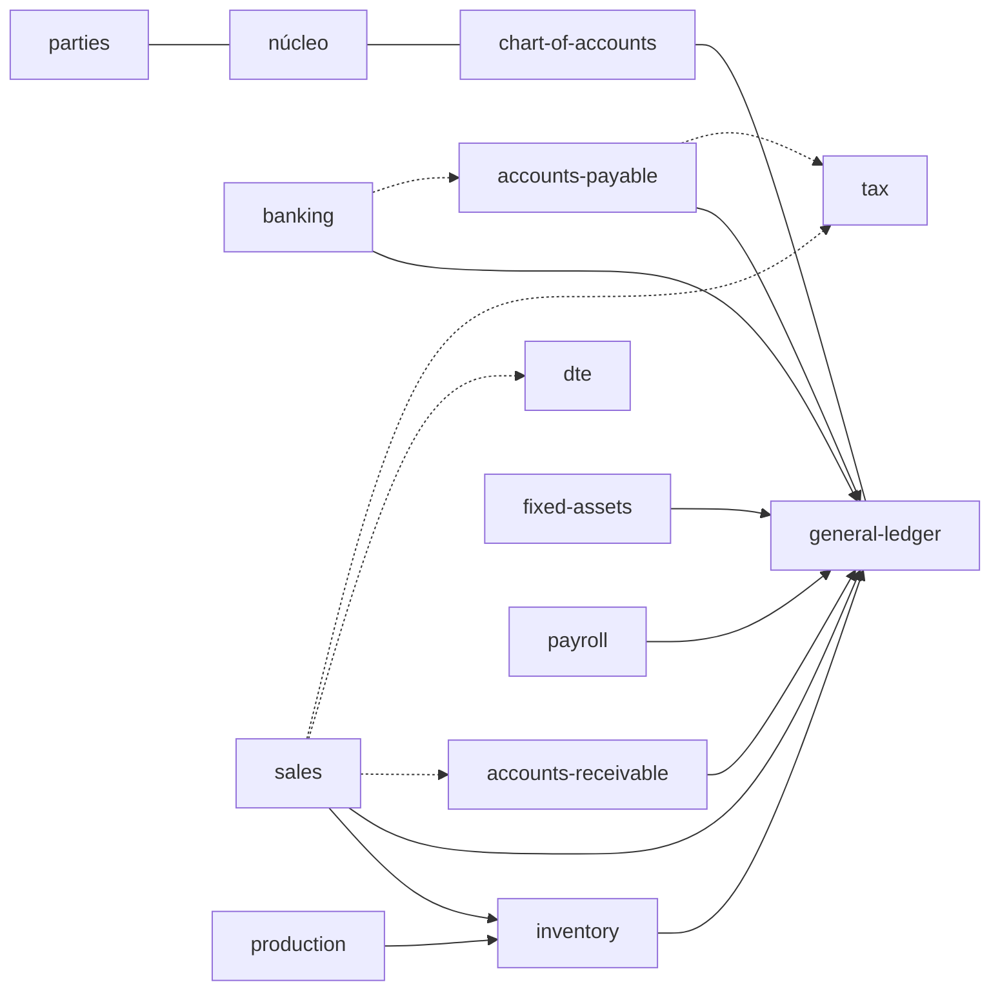

# El sistema completo en una página

Punto de entrada para quien se suma al proyecto: qué es el sistema anterior, qué es la plataforma nueva, cómo se
corresponden, en qué orden se construye y dónde leer cada cosa.

> **Advertencia sobre las fuentes.** Los specs de `docs/legacy/` (uno por módulo) y los dos mapas de esta carpeta fueron
> escritos por **análisis automatizado** del código fuente y de la estructura de los datos. **No se han verificado línea
> por línea ni revisado con el negocio.** El diseño de esta carpeta (`modulos-y-orden.md`, `contratos.md`) es una
> **propuesta** hecha sin el dueño presente; lo que debe decidir el negocio está en [PREGUNTAS.md](../legacy/PREGUNTAS.md)
> (P1–P30) y en las preguntas M1–M4 de [modulos-y-orden.md](modulos-y-orden.md#5-riesgos-y-decisiones-abiertas).
> Nada legal (IVA, DTE, ISSS, AFP, renta, depreciación) se afirma como norma.

## 1. El sistema anterior (MCERP)

ERP en Visual FoxPro 9: **ocho aplicaciones independientes** (cada una con su ejecutable, menú, login y copia de las
tablas de usuarios) más una solución externa de factura electrónica.

| Módulo legado | Para qué |
|---|---|
| CONTAC | Contabilidad general; **aloja en su carpeta las tablas de Bancos y CxP** |
| BANCOC | Bancos (cheques, remesas, conciliación) y Cuentas por pagar |
| INV64 | Inventario **y facturación** (CCF, consumidor final, exportación, notas) y cola hacia el DTE |
| cxc64 | Cuentas por cobrar |
| IVA64 | Libros de IVA, renta retenida, archivos para Hacienda |
| LOTE64 | Producción (fórmulas, órdenes, costeo) |
| AFIJO64 | Activo fijo y depreciación |
| plan64 | Planilla y RR. HH. |
| `factura-electronica-mc` (.NET) | Firma y transmite los DTE; lee y escribe dos tablas de INV64 |

**Cómo se pegan:** no hay contratos. Cada módulo arma un `SET PATH` con las carpetas de los otros y abre tablas por
nombre; gana la primera carpeta que tenga la tabla. Todos escriben directo en las partidas de CONTAC con cinco versiones
distintas de la rutina `CGADIPAR`, casi siempre por **lotes manuales de rango de fechas** y sin marca de origen.

**Problemas estructurales** (detalle en [integracion-legado.md](integracion-legado.md)):
1. **Sin transacciones** en ningún módulo: un corte deja tablas a medias.
2. **Sin vínculo documento → partida** salvo Bancos; `GENERADO = 0` es la norma; los lotes se pueden repetir, traslapar
   o dejar huecos, y reemplazar no revierte saldos.
3. **Ventas contabilizadas desde dos módulos** (INV64 y cxc64) sin candado.
4. **Seis mecanismos de cierre** que no se sincronizan; producción y planilla escriben en meses cerrados.
5. **Maestros duplicados**: proveedores en dos carpetas (73 y 80 filas), clientes en tres, tasas de IVA en cinco fuentes
   y 21 sitios del código.
6. **Saldos guardados** (`SALDOS`, `BODMES`, `VACUMULA`…) que ya no cuadran con sus movimientos.
7. **Capa compartida que no es compartida**: ocho copias de usuarios, permisos (630 claves de pantalla) y empresas;
   la clave se guarda como suma de caracteres (ver [plataforma-compartida.md](plataforma-compartida.md)).

Diagrama de flujos entre módulos legados: [integracion-legado.md §1.3](integracion-legado.md#13-diagrama).

## 2. La plataforma nueva

1. **Una instalación por cliente** en su red local: un servidor con la API (Hono) y una base SQLite **cifrada**; varias
   empresas en la misma base (`empresa_id` en toda tabla de negocio).
2. **La API es el único escritor**; transacciones síncronas de better-sqlite3; dinero como decimal exacto en texto; sin
   borrados físicos; bitácora en la misma transacción.
3. **Módulos** en `modules/` con su schema (Drizzle, prefijo propio), rutas y manifiesto; **no se importan entre sí** ni
   importan `apps/api`; solo `@accounting/shared`.
4. **Contratos**: servicios que la plataforma pone en el contexto del módulo (`ledger`, `periods`, `stock`,
   `receivables`, `payables`, `taxBooks`, `dteOutbox`, lookups, `settings`, `sequences`) con una transacción compartida.
5. **Web** en español, con el flujo familiar del sistema anterior (barra de íconos, encabezado + líneas, totales).

Detalle: [architecture.md](../architecture.md), [module-guide.md](../module-guide.md), [web-guide.md](../web-guide.md),
[contratos.md](contratos.md).

## 3. Del legado a los módulos nuevos

| Legado | Módulo(s) nuevo(s) |
|---|---|
| CONTAC | `chart-of-accounts` + `general-ledger` (hechos) |
| BANCOC — Bancos | `banking` |
| BANCOC — Cuentas por pagar; "Provisionar" de INV64; sujeto excluido | `accounts-payable` |
| cxc64 | `accounts-receivable` |
| INV64 — artículos, movimientos, kárdex | `inventory` |
| INV64 — facturación | `sales` |
| INV64 `FELECTRO`/`FANULAR` + solución .NET | `dte` (primero bandeja compatible, después propio) |
| IVA64; "Ingresar al IVA / Renta" | `tax` |
| LOTE64 | `production` |
| AFIJO64 | `fixed-assets` |
| plan64 | `payroll` |
| `CCCLI01`, `PROVEDOR` ×2, `CONTRIBU`, `CLIENTES` | `parties` (maestro único de terceros) |
| `USUARIOS`/`PERFIL`/`USREMP`/`BITACORA`/`EMPRESAS` ×8, `.MEM`, `MESACT`, cierres | **núcleo de la plataforma** (usuarios, permisos por acción, empresas, bitácora, configuración, correlativos, períodos) |

Dependencias de los módulos nuevos (resumen; el diagrama completo está en
[modulos-y-orden.md §1.5](modulos-y-orden.md#15-diagrama-de-dependencias)):

Reglas que lo sostienen: el dueño del documento contabiliza su documento (una partida viva por documento, inmediata, en
la misma transacción); una tabla de cierre por empresa, mes y área; impuestos calculados y congelados en el documento de
origen; saldos y existencias calculados desde movimientos.

## 4. Hoja de ruta

| Fase | Contenido | Abre |
|---|---|---|
| 0 | Cimientos: períodos, configuración, correlativos, permisos por acción, activación por empresa, `parties`, contrato de contabilización | — |
| 1 | `banking` + `accounts-payable` | primer flujo inmediato al GL |
| 2 | `fixed-assets` | **piloto 1**: cliente de contabilidad + bancos + activo fijo |
| 3 | `tax` | piloto 1 con IVA de compras |
| 4 | `inventory` + `sales` + `accounts-receivable` + `dte` (bandeja compatible) | **piloto 2**: cliente que factura |
| 5 | `production` | clientes que fabrican |
| 6 | `payroll` | clientes con planilla |
| 7 | DTE propio | retirar la solución .NET |

Convivencia: por **anillos** que se mueven completos (pagos; facturación), con puentes de una sola vía del legado al
nuevo por mes cerrado. Detalle en [modulos-y-orden.md §3](modulos-y-orden.md#3-orden-de-construcción).

## 5. Estado actual (de [REPORTE.md](../legacy/REPORTE.md), 2026-11-10)

- **Hecho:** núcleo (empresas, usuarios y roles, bitácora, base de módulos); `chart-of-accounts` (34 pruebas) y
  `general-ledger` (35 pruebas: partidas, cierres, 6 reportes, cierre anual); importador de CONTAC probado con datos reales
  (619 cuentas, 5,220 partidas, 48,024 líneas); pantallas de contabilidad que cargan con datos reales. 81 pruebas en la API.
- **Paridad:** el balance de comprobación cuadra con el cálculo independiente en 18,570 saldos; contra la tabla `SALDOS`
  del legado **no cuadra limpio** (2,444 filas, atribuidas a datos viejos).
- **Specs escritos, sin revisar con el negocio:** los ocho módulos y la solución DTE.
- **No probado:** captura de partidas con teclado, impresión, apariencia.
- **Bloqueos:** `MCERP/` mezcla clientes y fechas; solo hay una empresa en disco; faltan reportes impresos para la paridad.

## 6. Guía de lectura

| Documento | Responde |
|---|---|
| [docs/sistema/README.md](README.md) | Esta página: el panorama |
| [docs/sistema/integracion-legado.md](integracion-legado.md) | Cómo se tocan los módulos legados: tablas, flujos, `CGADIPAR`, cierres, maestros duplicados |
| [docs/sistema/plataforma-compartida.md](plataforma-compartida.md) | Usuarios, permisos, empresas, bitácora y `.MEM` del legado, y qué falta en la plataforma |
| [docs/sistema/modulos-y-orden.md](modulos-y-orden.md) | Qué módulos habrá, quién posee qué, reglas transversales, orden de construcción, convivencia, cambios a lo hecho |
| [docs/sistema/contratos.md](contratos.md) | Cómo se hablan los módulos: contabilización, períodos, existencias, CxC/CxP, libros, DTE, maestros, configuración |
| [docs/architecture.md](../architecture.md) | Despliegue servidor/clientes en red local |
| [docs/module-guide.md](../module-guide.md) | Cómo se construye un módulo (reglas, contexto, pruebas) |
| [docs/web-guide.md](../web-guide.md) | Cómo se construyen las pantallas |
| [docs/legacy/README.md](../legacy/README.md) | Cómo se lee el legado, decisiones tomadas, progreso por módulo |
| [docs/legacy/REPORTE.md](../legacy/REPORTE.md) | Estado, paridad, supuestos S1–S19, bloqueos |
| [docs/legacy/PREGUNTAS.md](../legacy/PREGUNTAS.md) | Las preguntas al negocio, priorizadas, con propuesta |
| [docs/legacy/contac/](../legacy/contac/README.md) | Contabilidad (incluye `import.md`, el importador) |
| [docs/legacy/bancoc/](../legacy/bancoc/README.md) | Bancos y Cuentas por pagar |
| [docs/legacy/cxc64/](../legacy/cxc64/README.md) | Cuentas por cobrar |
| [docs/legacy/inv64/](../legacy/inv64/README.md) | Inventario, facturación y cola DTE |
| [docs/legacy/dte/](../legacy/dte/README.md) | La solución de factura electrónica existente |
| [docs/legacy/iva64/](../legacy/iva64/README.md) | Libros de IVA y archivos para Hacienda |
| [docs/legacy/lote64/](../legacy/lote64/README.md) | Producción |
| [docs/legacy/afijo64/](../legacy/afijo64/README.md) | Activo fijo |
| [docs/legacy/plan64/](../legacy/plan64/README.md) | Planilla |

Cada carpeta de módulo legado tiene `README.md` (menú → destino), `business-rules.md`, `data-model.md` (incluye el modelo
propuesto) y `open-questions.md`.
