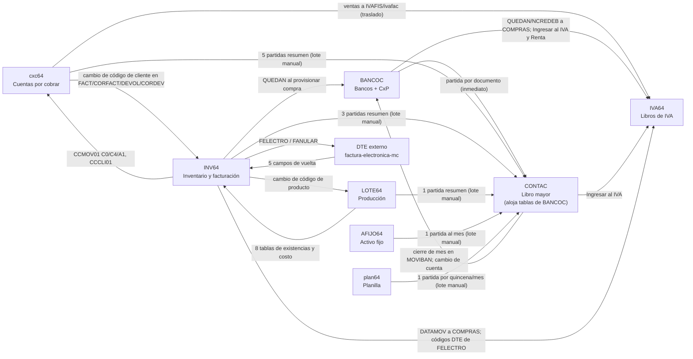

# Mapa de integración del sistema anterior (MCERP)

Un solo mapa de cómo los módulos del sistema anterior (Visual FoxPro 9) se tocan los datos entre sí. Reúne y
verifica contra el código fuente lo que los nueve specs de `docs/legacy/` dicen por separado. La capa compartida
(usuarios, permisos, empresas, bitácora, configuración) está en [plataforma-compartida.md](plataforma-compartida.md).

> **Cómo leerlo.** Etiquetas: **[V]** verificado por mí en el código fuente o en la estructura/conteos de los
> `.DBF`/`.MEM` al preparar este documento; **[S]** tomado de un spec de módulo sin repetir la verificación;
> **[I]** deducción mía, no probada. Donde un spec y el código discrepan, gana el código y se dice en §7.
> No hay datos de clientes: solo estructura, nombres de campo y de variable, conteos y textos de menú.
> **Límite de la evidencia:** `MCERP/` mezcla copias de clientes y fechas distintos (ver `REPORTE.md`, Bloqueos).
> Lo que se afirma del *código* vale para cualquier cliente; lo que se afirma de los *datos* vale solo para esa copia.

---

## 1. El sistema en una página

### 1.1 Los módulos

Son **ocho aplicaciones independientes** (cada una con su propio ejecutable, proyecto, menú, login y carpeta de
programa) más una novena pieza externa. No comparten código en tiempo de ejecución: comparten **carpetas de datos**
y **copias del mismo código fuente** (ver plataforma-compartida §6).

| Módulo | Ejecutable / proyecto vivo [V] | Para qué sirve | Carpeta de datos (`EMPRESAS.CAMINO`) | Carpeta de programa (tablas de sistema) |
|---|---|---|---|---|
| CONTAC | `cont64.exe` / `CONT.PJX` | Contabilidad general: catálogo, partidas, saldos, cierres, presupuestos. **Aloja además las tablas de Bancos y CxP** | `CONTAC\dbf` | `CONTAC\fuente` |
| BANCOC | `banco64.exe` / `BANCO64.PJX` | Bancos (cheques, remesas, conciliación) y Cuentas por pagar | **`CONTAC\dbf`** (BANCOC no tiene `dbf` propio) | `BANCOC\fuente` |
| INV64 | `invent64.exe` / `INVENT64.PJX` | Inventario, facturación (CCF, consumidor final, exportación, notas), sujeto excluido, cola hacia el DTE | `INV64\DBF` | `INV64\FUENTE` |
| cxc64 | `cxc64.exe` (también `cxc.exe`, `cxc64PP.exe`) / `cxc64.pjx` | Cuentas por cobrar: cartera, abonos, cobranza | `cxc64\DBF` | `cxc64\FUENTE` |
| IVA64 | `iva64.exe` / `iva.pjx` | Libros de IVA (compras, ventas), renta retenida, archivos para Hacienda | `IVA64\dbf` | `IVA64\FUENTE` |
| LOTE64 | `lote64.exe` / `lote.pjx` | Producción: fórmulas, órdenes, costeo | `LOTE64\DBF` | `LOTE64\FUENTE` |
| AFIJO64 | `AFIJO.EXE` / `afijo.pjx` | Activo fijo y depreciación mensual | `AFIJO64\DBF` | `AFIJO64\fuente` |
| plan64 | `planilla.exe` / `PLANILLA.PJX` | Planilla quincenal, ISSS/AFP/renta, aguinaldo, RR. HH. | `plan64\dbf` | `plan64\fuente` |
| DTE (externo) | Repositorio .NET aparte `factura-electronica-mc` (cliente WPF x86) | Firma, transmite y reporta los documentos tributarios electrónicos | Lee los `.DBF` de INV64 (`DBFPath`) | Su propia configuración fuera del ERP |

- Cada carpeta de programa trae **su propia copia** de `EMPRESAS`, `USUARIOS`, `PERFIL`, `USREMP` y (en cinco módulos)
  `BITACORA` [V]. No hay una tabla de usuarios compartida; ver plataforma-compartida §1.
- BANCOC tiene dos "carpetas de verdad": su programa en `BANCOC\fuente`, sus datos en `CONTAC\dbf`. Por eso
  `CONTAC\dbf` contiene tres módulos de datos: contabilidad, bancos y cuentas por pagar [V].
- **La solución DTE no es del ERP:** solo conversa con él por dos tablas (`FELECTRO`, `FANULAR`) [V; ver §3.F].

### 1.2 Cómo cada módulo llega a las carpetas de los otros

Ningún módulo hace `USE <ruta>\tabla`. Al elegir empresa, `selemp.prg`/`access.prg` leen la fila de `EMPRESAS` y
arman un `SET PATH TO` con varias carpetas; después el código abre las tablas **sin ruta** (`USE partidas`) y
FoxPro las busca **en orden: primero la carpeta de trabajo, luego la ruta** [V].

| Módulo | Campos de `EMPRESAS` que se usan como ruta, en el orden del `SET PATH` [V] | A qué carpeta apuntan en la copia del disco [V] |
|---|---|---|
| CONTAC | `CAMINO`; `CAMINOIVA` | `contac\dbf`; `iva64\DBF` |
| BANCOC | `CAMINO`; `IVA` | `contac\DBF`; `iva64\DBF` |
| INV64 | `CAMINO`; `CXC`; `BANCOS`; `LOTE`; `RUTAFOTO`; `RUTAINV`; `RUTAPDF` | `inv64\DBF`; `cxc64\dbf`; `contac\dbf`; (vacío); fotos; **una carpeta de IVA64 bajo otra raíz que no existe en esta copia**; carpeta de PDF |
| cxc64 | `CAMINO`; `CAMINO2`; `CAMINOINV` | `cxc64\DBF`; `contac\dbf`; `INV64\DBF` |
| IVA64 | `CAMINO`; `INTEGRA`; `INTEGRAP`; `RUTAINV` | `iva64\dbf`; `cxc64\dbf`; **una carpeta de CONTAC bajo otra raíz que no existe en esta copia**; `INV64\DBF` |
| LOTE64 | `CAMINO`; `INTEGRA`; `CONTA` | `LOTE64\DBF`; `INV64\dbf`; `contac\dbf` |
| AFIJO64 | `CAMINO`; `INTEGRA`; `CONTA` | `AFIJO64\DBF`; **`INV64\DBF`**; `contac\DBF` |
| plan64 | `CAMINO`; `CAMINO2`; `CAMINOIVA` | `plan64\dbf`; `contac\DBF`; `IVA64\DBF` |

Consecuencias que importan al diseño:

1. **La resolución es por nombre de tabla y orden de carpetas, no por contrato.** Si una tabla existe en dos
   carpetas, gana la primera del `SET PATH` [V]. Casos verificados en el disco (conteos de filas vivas):

   | Tabla | Copias | Quién ve cuál |
   |---|---|---|
   | `PROVEDOR` | `CONTAC\dbf` (73) e `INV64\DBF` (80) | INV64, **AFIJO64 y LOTE64** ven la de INV64 (su ruta pone `INV64` antes que `CONTAC`); BANCOC, CONTAC e IVA64 ven la de CONTAC |
   | `COMPRAS`, `IVAFIS`, `IVAFAC`, `CONTRIBU`, `CLIENTES`, `RENTAT` | `IVA64\dbf` (19,494 / 47,516 / 802 / 610 / 1,158 / 3) e `INV64\DBF` (16,333 / 46,925 / 1,398 / 624 / 766 / 1) | INV64 escribe en **su propia copia** (con menos columnas: 27 de 49 en `COMPRAS`, 19 de 26 en `IVAFIS`, 12 de 27 en `IVAFAC`); IVA64, BANCOC y CONTAC escriben en la de IVA64 |
   | `CIERRE` | `CONTAC\dbf` (0 filas, 2 col.), `INV64\DBF` (164), `cxc64\DBF` (0), `plan64\dbf` (0) | LOTE64 y AFIJO64 leen el `CIERRE` de INV64; son cuatro tablas distintas con el mismo nombre |
   | `CCDEP01`, `CCMUN01` | `cxc64` (15 / 261) e `IVA64` (24 / 287) | catálogos geográficos con contenido distinto |
   | `BANCOS` | `CONTAC` (3), `cxc64` (26, bancos de clientes), `plan64` (2), `INV64` (0) | cuatro catálogos distintos con el mismo nombre y código de 2 caracteres |

2. **Rutas rotas o heredadas no avisan:** `IVA64.INTEGRAP` apunta a una carpeta inexistente y el módulo sigue
   arrancando; `AFIJO64.INTEGRA` apunta a INV64 aunque el módulo no usa inventario; su único efecto visible es que `PROVEDOR` se resuelve a la copia de INV64 [V].
3. **Cuando un módulo usa el `SET PATH`, ve *todas* las tablas de las otras carpetas**, también las que no
   debería tocar. No hay control de acceso por tabla [V].
4. `EMPRESAS` y `USUARIOS` viven en la carpeta de programa, no en la de datos; `INV64\DBF\EMPRESAS.DBF` es una
   copia vacía sin uso [V].

### 1.3 Diagrama

Una flecha por par de módulos y dirección: **el dato va del origen al destino**; trazo continuo = escribe en tablas
del destino; trazo punteado = solo lee. Quién ejecuta la copia (el origen o el destino) está en §3.

---

## 2. Matriz de propiedad de tablas

Leyenda: **L** lee · **E** escribe (alta o cambio) · **B** borra (físico, `DELETE`) · **—** no la toca.
"Dueño" = módulo cuya pantalla de mantenimiento la administra. Evidencia de escritura: búsqueda de `REPLACE`,
`APPEND`, `DELETE`, `GATHER` sobre el alias de la tabla en el código **vivo** de cada proyecto (`.pjx`), revisada a mano
en los casos de peso [V]. Una "E" de módulo no dueño significa que existe código vivo que escribe, no que se ejerza.

### 2.1 Libro mayor (carpeta `CONTAC\dbf`)

| Tabla | Dueño (pantalla) | CONTAC | BANCOC | INV64 | cxc64 | LOTE64 | AFIJO64 | plan64 | IVA64 |
|---|---|---|---|---|---|---|---|---|---|
| `PARTIDAS` | CONTAC (`cgmpar01`) | E B | E B | E B | E B | E B | E B | E B | — |
| `DETAPART` | CONTAC (`cgmpar01`) | E B | E B | E B | E B | E B | E B | E B | — |
| `SALDOS` | CONTAC (posteo; `cgadipar`) | E | E | E | E | E | E | E | — |
| `SALDOCC` | CONTAC (posteo; `cgadipar`) | E | E | E | E | — | — | — | — |
| `CATALOGO` | CONTAC (`cgmcat01`, `catimp`, `cgchcta`) | E B | L | L | L | L | L | L | — |
| `TIPOPAR` | CONTAC (`cgmtip01`) | E B | L | L | L | L | L | L | — |
| `CCOSTO` | CONTAC (`cgmcosto`) | E B | L | — | — | — | L | L | — |
| `PERIODO`, `PRESUP`, `AGRUPA`, `ESTADO01-04`, `CIERRE1/2` | CONTAC | E B | — | — | — | — | — | — | — |

Qué escribe cada módulo en estas tablas [V]:

- **`PARTIDAS`** (7 campos: `TIPOPAR`, `NUMERO`, `CONCEPTO`, `FECHA`, `SALFEC`, `CERRADO`, `GENERADO`): todos los
  módulos escriben el encabezado con la rutina `CGADIPAR` (§4). **No hay id, ni empresa, ni usuario, ni fecha de
  creación**: la clave es `SALFEC + TIPOPAR + NUMERO`. `GENERADO` queda en `0` (CxC, INV64, LOTE64, AFIJO64, planilla
  pasan `sistema = 0`), en blanco (BANCOC: la línea que lo escribía está comentada), o `9` (`CGADIPA2`, remesa
  concentrada). `CERRADO` nunca se escribe al crear: nace en `.F.`.
- **`DETAPART`** (11 campos): los llamantes llenan `SALFEC, TIPOPAR, NUMERO, CUENTA, DETALLE, CARGO, ABONO, TIPOMOV,
  FECHA, CCOSTO`; `FCOBRO` solo lo usa CONTAC. Sin id de línea.
- **`SALDOS`** (`SALFEC, CUENTA, SALDOANT, CARGOS, ABONOS, SALDO, SALDOMES`): la rutina compartida crea la fila
  `cuenta + mes` si no existe y suma `CARGOS/ABONOS` en la cuenta y en **toda la cadena de padres**
  (`CATALOGO.ANTERIOR`); recalcula `SALDO` y `SALDOMES`. El mes es la variable `mesact` **del módulo que llama**, no el
  mes de la partida (§4.3).
- **`SALDOCC`** (igual más `CCOSTO`): CONTAC y BANCOC por el centro de costo de cada línea; **cxc64 e INV64 por un único
  centro `cfg_centro`**, no por el de la línea; LOTE64, AFIJO64 y planilla **no la actualizan** (su copia de la rutina
  no tiene esa sección) [V].
- **`CATALOGO`, `TIPOPAR`, `CCOSTO`**: solo CONTAC los mantiene. Los demás los leen para validar o elegir
  cuentas (`config2`, `ccpart*`). `TIPOPAR.NUMERO` también la escribe CONTAC al elegir mes de trabajo
  (`cgselmes`: pone "último número del mes + 1" por tipo, con `FLOCK`) [V]. `cgchcta` ("Cambiar número a una cuenta")
  reescribe `CATALOGO, DETAPART, DETABANK, PROVISIO, SALDOS, PRESUP, ESTADO03` — **no** `SALDOCC` ni ninguna tabla
  de otros módulos (§6).

### 2.2 Bancos y Cuentas por pagar (carpeta `CONTAC\dbf`, dueño BANCOC)

| Tabla | Contenido | BANCOC | CONTAC | INV64 | cxc64 | IVA64 | LOTE64 / AFIJO64 |
|---|---|---|---|---|---|---|---|
| `CTABANCO` | cuentas bancarias (guarda `CUENTA`, cuenta contable) | E | — | — | L (reportes de cobros y liquidación) | — | — |
| `BANCOS`, `TMOV`, `COMPROB`, `CLASIF` | catálogos | E | — | L (`COMPROB`) | — | L (`COMPROB`) | — |
| `MOVIBAN` | documento bancario (cheque, remesa, NC, NA, transferencia); guarda `TIPOPAR + NUMERO + SALFEC` de su partida | E B | E (`CERRADO` al cerrar/abrir mes) | — | — | — | — |
| `DETABANK` | copia de las líneas de la partida | E | E (`CUENTA` en `cgchcta`) | — | — | — | — |
| `QUEDAN` | documento por pagar; guarda `TIPOPAR + NUMDOC` de la partida de provisión | E | — | **E B** (`inprovi`) | — | L | — |
| `MOVQUE` | pago aplicado a un documento | E B | — | — | — | — | — |
| `NCREDEB` | notas de crédito/débito de CxP | E B | — | — | — | L | — |
| `PROVISIO` | líneas de provisión de cada documento | E B | E (`CTA` en `cgchcta`) | B (solo `sbmfac01`, fuera del menú de INV64) | — | — | — |
| `PROVEDOR` | proveedores (ver §6) | E (`sbmpro01`) | — | E en **su copia** (`inmpro01`) | — | L | L (copia de INV64) |
| `NOMBRES`, `ESTCXP`, `UNIDADES` | proveedor "solo nombre", trabajo, sucursales | E | — | L (`NOMBRES`) | — | — | — |

- Detalle de lo que escribe INV64 en `QUEDAN`: el botón "Provisionar" de la pantalla de compra (`inmmov03` →
  `inprovi`) inserta el documento por pagar con proveedor, tipo de comprobante y número; el único vínculo con la compra de
  inventario es ese par proveedor + comprobante, **no hay llave hacia `DATAMOV`** [V + S].
- IVA64 solo **lee** `QUEDAN`, `NCREDEB`, `PROVEDOR` (los copia a `COMPRAS`/`CONTRIBU` al trasladar). No escribe aquí [V].
- `MOVIBAN` es la única tabla que une un documento bancario con una partida. Sin id; el vínculo es el trío
  `TIPOPAR + NUMERO + SALFEC` [V].

### 2.3 Cuentas por cobrar, facturación y DTE

| Tabla | Carpeta | Dueño | INV64 | cxc64 | IVA64 | DTE externo | Otros |
|---|---|---|---|---|---|---|---|
| `CCMOV01` (cartera: facturas `C0`, notas `C4/A1/A3/A6`, abonos `A0`…) | `cxc64\DBF` | cxc64 (`ccmmov01…06`) | **E B** (`C0`, `C4`, `A1`) | E B | L | — | — |
| `CCCLI01` (clientes de cartera) | `cxc64\DBF` | cxc64 (`ccmcli01`) | **E** (copia de la pantalla `ccmcli01`; y "última venta" `FULVENTA` en `inmfac01/03`) | E B | L | — | — |
| `CCTMOV` (tipos de movimiento + cuentas contables `CTA, CTA2, CCTAE`) | `cxc64\DBF` | cxc64 (`ccmtmov1`) | L | E | L (y copia propia en `IVA64\fuente`) | — | — |
| `CIERREC` | `cxc64\DBF` | cxc64 | L | E B | — | — | — |
| `CCVEND`, `CCDEP01`, `CCMUN01`, `PAIS`, `TNEGOCIO`, `DESPACHO`, `DETADES` | `cxc64\DBF` | cxc64 | **E** (copias de las pantallas en INV64) | E | `CCDEP01`/`CCMUN01` propios | — | — |
| `CORFACT`, `FACT` (encabezado y líneas de factura) | `INV64\DBF` | INV64 | E B | E (solo en `camcli01`, `camdoc01`: cambio de código/documento) | — | — | — |
| `CORDEV`, `DEVOL` (notas de crédito) | `INV64\DBF` | INV64 | E B | E (mismas utilidades) | — | — | — |
| **`FELECTRO`** (cola de DTE, una fila por línea; 35,944 vivas + 7,403 borradas) | `INV64\DBF` | INV64 | **E B** (8 pantallas de venta) | L | L (`CODGENERAC, NCONTROL, SELLORE`) | **E** (solo `PROCESADO, FALLO, NCONTROL, CODGENERAC, SELLORE`) | — |
| **`FANULAR`** (cola de invalidaciones; 520 vivas) | `INV64\DBF` | INV64 | **E** | — | — | **E** (mismos 5 campos) | — |

- **`CCMOV01` fila de factura `C0`**: la crea INV64 al grabar `inmfac01` (CCF), `inmfac03` (consumidor final) e
  `inmexp01` (exportación) y la **reescribe** al imprimir; la nota de débito `C4` la crea la copia de `ccmmov02` que
  viaja en INV64; la nota de crédito `A1` se escribe al imprimir (`inmdevol`, `inmdevo2`); `incuadre` crea la `C0`
  que falte a partir de `CORFACT`; `cambianu` también la toca [V]. Los campos que INV64 llena son
  `FTMOV, FFEC, FREF, FNFAC, FCTA, FMON, FVALIVA, FEXEN, FGRAV, FTICOM, FVEND, FPLAZO, FFPAGO, IVAPER, FLETE,
  NSERIE, NRESOLU, USUARIO, TRANSPORTE, PESO, PORCOMI` [S].
- El vínculo factura de INV64 ↔ fila de cartera es `CORFACT.número = CCMOV01.FREF` + tipo; no hay id [V + S].
- `FELECTRO.PROCESADO` es lógico y `FANULAR.PROCESADO` numérico (1 carácter): mismo nombre, tipos distintos [V].
- El programa DTE escribe de vuelta con `UPDATE … SET procesado, fallo, Ncontrol, Codgenerac, Sellore WHERE NFACT_ENV = ? AND TIPODTE = ?`
  (todas las líneas del documento a la vez) [V `FacturaElectronicaMC/DataAccess.cs`].

### 2.4 Inventario y producción

| Tabla | Dueño | INV64 | LOTE64 | AFIJO64 | cxc64 |
|---|---|---|---|---|---|
| `ARTICULO` (maestro de productos; `BODEGA1..15`, `EXIST_ACT`, `COSTO_PROM`, cuentas `CTA/CTAVENTA/CTACOSTO`) | INV64 (`inmart1`) | E B | **E** (`BODEGAn`, `EXIST_ACT`, costos) | — | L |
| `DATAMOV` (encabezado de movimiento), `MOVIMIEN` (líneas) | INV64 (`inmmov0x`) | E B | **E B** (conceptos de producción) | — | — |
| `BODMES`, `MESES`, `SALDOLO` (saldos por bodega/mes, producto/mes, lote) | INV64 (posteo) | E | **E** | — | — |
| `VENCE2` (lotes con vencimiento) | INV64 | E | **E** | — | — |
| `DPEDI` (orden de compra, `RECIBIDO`) | INV64 | E | **E** | — | — |
| `CIERRE` (meses cerrados de inventario) | INV64 (`cierre1`, `inabre`) | E B | L (solo "Recalcular costos") | L (`posteo`, no expuesto en el menú) | — |
| `LOTE`, `DETALOTE`, `FORMULA`, `DETAFORM` (producción) | LOTE64 | E (**solo** la utilidad "Cambiar código a un producto": `cambia`) | E B | — | — |

- LOTE64 escribe **ocho** tablas de INV64: `ARTICULO, BODMES, DATAMOV, DPEDI, MESES, MOVIMIEN, SALDOLO, VENCE2`
  [V]. Los specs (`lote64/README.md`, `inv64/business-rules.md` §13.7) dicen "nueve" pero enumeran estas ocho.
- No hay transacción alrededor de ninguno de estos grabados [V; ver `inv64` §1.5].
- AFIJO64 trae el código de posteo de inventario (`posteo.scx`, `posmov.prg`, que tocan `MOVIMIEN` y `LOTE`) dentro de su
  proyecto, pero **su menú no lo expone** [V]: código heredado, no flujo.

### 2.5 Libros de IVA y renta (carpeta `IVA64\dbf`, dueño IVA64)

| Tabla | IVA64 | CONTAC | BANCOC | INV64 | Cómo se alimenta |
|---|---|---|---|---|---|
| `COMPRAS` (libro de compras, excluidos y renglones de retención; 49 columnas) | E B (captura, JSON de DTE, CSV, cierre/apertura) | E (`ivacomp2` vía "Ingresar al IVA") | E (`ivacomp2`) | E en **su copia** de 27 columnas (`ivaexcl`, `ivaexcl2`) | traslado de `QUEDAN/NCREDEB` (`ivatraco`) y de `DATAMOV` (`ivatrac2`), captura manual, CSV |
| `IVAFIS` (ventas a contribuyentes; 26 col.) | E B | — | — | solo su copia | traslado desde `CCMOV01` (`ivatranc`) |
| `ivafac` (consumidor final, resumen por rangos; 27 col.) | E B | — | — | solo su copia | traslado desde `CCMOV01` (`ivatranf`, agrupa por día) |
| `CONTRIBU` (proveedores fiscales, 610) | E B | E (`ivmcon01`) | E (`ivmcon01`) | su copia | se llena al trasladar compras y a mano |
| `CLIENTES` (clientes fiscales, 1,158) | E B | — | — | su copia | `ivatranc` copia desde `CCCLI01` por NRC |
| `RENTAT` (renta retenida, 3) | E | — | E (`ivarenta`, `sbmfac01`) | su copia | captura |
| `CCTMOV` (copia con 18 tipos, en `IVA64\fuente`) | L | — | — | — | copia de la de cxc64 |

- **Ninguna fila de `COMPRAS/IVAFIS/ivafac` guarda el identificador del documento origen**; solo coinciden número
  (`FCOMP`) y tipo (`FTIPO`) [V; confirma `iva64/data-model.md`]. La marca `TRANSF = .T.` solo dice "vino de un traslado".
- IVA64 **no escribe** `PARTIDAS`, `DETAPART` ni `SALDOS` [V] (los hits en `cnempre`/`cnperfil` son pantallas de
  usuarios que reutilizan el alias).

### 2.6 Tablas de usuarios, permisos, empresas y auditoría

Cada módulo tiene su propia copia en su carpeta de programa; estructura y conteos en plataforma-compartida §1–§4.

| Tabla | CONTAC | BANCOC | INV64 | cxc64 | IVA64 | LOTE64 | AFIJO64 | plan64 |
|---|---|---|---|---|---|---|---|---|
| `USUARIOS` (vivos/borrados) | 4/0 | 9/34 | 3/0 | 2/9 | 2/40 | 3/16 | 4/20 | 2/7 |
| `PERFIL` (vivos) | 205 | 424 | 513 | 220 | 88 | 89 | 11 | 266 |
| `USREMP` (vivos) | 10 | 37 | 3 | 22 | 4 | — | — | 9 |
| `BITACORA` (vivos) | 41 | 117 | 404 | 23,455 | 335 | no existe | no existe | no existe |
| `EMPRESAS` (vivas) | 1 | 1 | 1 | 1 | 1 | 1 | 1 | 1 |

---

## 3. Catálogo de flujos entre módulos

Convenciones: **Modo** = *inmediato* (al grabar el documento) o *lote* (lo lanza una persona con un rango de fechas).
"Sin reverso" = borra y vuelve a escribir sin restar lo que ya había sumado a `SALDOS`. "Vínculo" = qué une el
documento origen con lo que creó. Todos los flujos carecen de transacción y de marca "ya contabilizado" salvo que se
indique lo contrario [V en lo que toca código; S en el resto].

### 3.A Contabilización (hacia el libro mayor)

| # | Origen → destino (pantalla) | Disparador y modo | Qué escribe | Repetir / modificar / anular | Vínculo | Defectos conocidos |
|---|---|---|---|---|---|---|
| A1 | BANCOC → CONTAC (`sbmdoc01`) | Grabar cada cheque, remesa, NC, NA, transferencia. **Inmediato** | Una partida (tipo = `TMOV.TIPOPAR`) con la línea de banco, las contrapartidas y, si aplica, IVA/LIOF; copia las líneas en `DETABANK` [S] | Modificar: revierte saldos y borra la partida anterior y crea otra *con el número del formulario* (modo 2 + modo 1). Anular: líneas en cero, concepto " ANULADO " y saldos revertidos (modo 3). Eliminar cheque no impreso: modo 2. Imprimir/conciliar: no toca el GL | `MOVIBAN.TIPOPAR + NUMERO + SALFEC` (sin id) | `GENERADO` no se escribe → **CONTAC permite modificar la partida** (solo bloquea *eliminar* cuando `generado = 1`) [V]; `cgchgnum` (renumerar partida) cambia solo `PARTIDAS/DETAPART` y rompe el vínculo con `MOVIBAN` sin avisar [V]; `DETABANK` diverge de `DETAPART` (1,067 de 12,724 líneas sin pareja [S]); el saldo se suma al mes `mesact` de la sesión, no al de la partida (§4.3) |
| A2 | BANCOC → CONTAC (`qwgpro01`, "Generar provisión") | Lote manual por documentos de CxP elegidos | Una partida de provisión (`cgadipar` modo 1, `sistema = 0`); pregunta "Partida ya existe; Desea Eliminarla" y la **borra sin reverso**; revisa `PARTIDAS.CERRADO` [V] | Repetible: reemplaza si se reutiliza el número | `QUEDAN.TIPOPAR + NUMDOC`, `NCREDEB`, `PROVISIO` (líneas) | Sin marca de origen (`GENERADO = 0`); sin reverso de saldos |
| A3 | BANCOC → CONTAC y de vuelta (`sbreme01` → `CGADIPA2`) | Captura de partida directa | Partida con `GENERADO = 9` **y** una fila `MOVIBAN` por cada línea cuya cuenta es la cuenta contable de un banco | Modificar/eliminar: modos 2/1 | La misma llave `MOVIBAN` | Integración *inversa* (el GL crea movimientos bancarios); no actualiza `CTABANCO.CARGOS/ABONOS` [S] |
| A4 | cxc64 → CONTAC (`ccpart`, `ccpartde`, `ccpartna`, `ccpartab`, `ccpartre`) | **Lote manual** por rango de fechas, tipo y número de partida | Una partida **resumen por rango** (cliente, ingresos, IVA, retenciones, caja, postfechados); `SALFEC` = mes de la fecha inicial | Repetible *sin control*: no hay marca en `CCMOV01`; si el número existe se pregunta y se borra **sin reverso**; rangos traslapados duplican, huecos omiten. Anular = el usuario borra la partida en CONTAC | Solo el texto del concepto y el rango de fechas | Revisa `PARTIDAS.CERRADO` del primer registro del mes (inicio y fin del rango) [V]; **SALDOS en el mes `mesact` de cxc64**, que la pantalla no obliga a coincidir con el del rango [V]; `SALDOCC` por `cfg_centro` y centro "100" fijo en las líneas [V]; `GENERADO = 0`; las devoluciones omiten `IVAPER` y exento [S]; los `A5` nunca se contabilizan [S] |
| A5 | INV64 → CONTAC (`ccpartve` ventas, `ccpartco` costo, `ccpart` movimientos) | Lote manual por rango | Ventas: cliente / `ARTICULO.CTAVENTA` / IVA; costo: `CTACOSTO` contra `CTA`; movimientos: `CONCEPTO.CTA` contra `ARTICULO.CTA`. `SALFEC` = mes del **inicio** del rango, aunque abarque dos | Igual que A4 (pregunta y borra sin reverso) | Ninguno | Revisa mes cerrado en contabilidad [V]; omite en silencio líneas sin cuenta [S]; **ventas se contabilizan también desde cxc64 (A4)**: dos orígenes para el mismo hecho, sin candado entre ellos [V + S] |
| A6 | LOTE64 → CONTAC (`ccpartco`) | Lote manual por rango de órdenes | Partida de costos de producción | Igual que A4 | Ninguno | **No revisa mes cerrado** [V]; su copia de `CGADIPAR` no actualiza `SALDOCC` [V] |
| A7 | AFIJO64 → CONTAC (`ccpartco`, menú "Generar Partida de Depreciación") | Lote manual, una vez al mes | Una partida (gasto contra depreciación acumulada) y las filas `MOVDEPRE` | Igual que A4; revisa mes cerrado [V] | `MOVDEPRE.SALFEC + TIPOPAR + NUMERO` | Su `SALDOS` va al mes `mesact` [S + V]; sin `SALDOCC` |
| A8 | plan64 → CONTAC (`ccpartab`) | Lote manual por quincena | Una partida de planilla (cuentas del maestro y de los conceptos) | El número lo digita el usuario; si existe, la borra con todas sus líneas | Ninguno | **No revisa mes cerrado** [V]; cambia `mesact` a **7 caracteres** (`AAAAMMQ`) antes de llamar a `CGADIPAR`, que lo usa como llave de 6 en `SALDOS` [V] — efecto sin probar [I] (§4.3); puede salir descuadrada [S]; sin `SALDOCC` |
| A9 | CONTAC → CONTAC (`cgcierre`, cierre anual) | Manual, una vez al año | Borrador en `CIERRE1/2`; al aplicar llama a `CGADIPAR` modo 1 | — | Solo el concepto "CIERRE CONTABLE EJERCICIO" | La partida de cierre no lleva marca propia (`GENERADO` por omisión) [V + S] |
| A10 | CONTAC → BANCOC (`cgcmes01`, `cgames01`) | Cerrar / abrir mes | Marca `CERRADO` en **todas** las filas del mes de `PARTIDAS` y `MOVIBAN` | Abrir revierte (sin clave; bitácora) | El mes (`SALFEC`) | Ver §5 |

### 3.B Cuentas por cobrar

| # | Origen → destino | Disparador y modo | Qué escribe | Repetir / modificar / anular | Vínculo | Defectos conocidos |
|---|---|---|---|---|---|---|
| B1 | INV64 → cxc64 (`inmfac01`, `inmfac03`, `inmexp01`, `ccmmov02`, `inmdevol`, `inmdevo2`, `incuadre`, `cambianu`) | Al grabar la factura (**inmediato**); también al *imprimir/ticket* (la fila `C0` se reescribe con el total vigente); `A1` solo al imprimir la nota de crédito | `CCMOV01`: `C0` por factura, `C4` por nota de débito, `A1` por nota de crédito | Modificar = borrar y volver a insertar (revierte kárdex y `C0`). Eliminar: borra `C0`. Anular: `C0` queda con monto 0 y la factura con totales en 0. Se crea **o se sobrescribe por clave** | `CORFACT.número = CCMOV01.FREF` + tipo (`FTMOV`, `FTICOM`) | Grabado de 8 a 12 tablas **sin transacción**; una nota de crédito grabada pero no impresa nunca llega a cartera [S]; hay dos programas que escriben la misma tabla (cxc64 también edita `C0` a mano) |
| B2 | INV64 → cxc64 (`ccmcli01`, `inmfac01/03`, `inmpedi`, `inconcli`) | Alta/cambio de cliente en INV64; última venta | `CCCLI01` (cliente; `FULVENTA` y últimas compras) | Eliminar cliente en INV64 borra de la tabla de cxc64 | Código de cliente `FCTA` | Dos pantallas de mantenimiento de cliente (cxc64 e INV64) para la misma tabla [V] |
| B3 | cxc64 → INV64 (`camcli01`, `camdoc01`, "Cambiar código a un cliente", "Mover documento") | Utilidad manual | Reemplaza el código de cliente en `FACT, CORFACT, DEVOL, CORDEV` | No repetible de forma segura | Código de cliente | La única propagación de maestro entre los dos; no toca `IVA64\CLIENTES` ni `ivafis` |

### 3.C Cuentas por pagar

| # | Origen → destino | Disparador y modo | Qué escribe | Repetir / modificar / anular | Vínculo | Defectos |
|---|---|---|---|---|---|---|
| C1 | INV64 → `QUEDAN` en la carpeta de BANCOC (`inprovi`, botón "Provisionar" de `inmmov03`) | Al grabar la compra, si el proveedor tiene crédito y `cfg_prove` está activo. Inmediato | Documento por pagar (`PROVEDOR`, `TIPCOMP`, `COMPROB`, fechas, montos) | Eliminar la compra no revisa si ya se provisionó [I]. Validaciones: proveedor existe, comprobante no repetido, fechas | Proveedor + comprobante, sin llave hacia `DATAMOV` | Usa la copia de `PROVEDOR` de INV64 (80 filas) mientras CxP usa la de CONTAC (73): un proveedor puede existir en uno y no en el otro [V] |
| C2 | BANCOC (interno): cheque/transferencia → pagos aplicados | `sbmdoc01` con `qwcque01/02` | `MOVQUE`, y `QUEDAN.PAGOS/SALDO/CANCELADO` | Cancelación manual sin cheque (`sbmfac03`) **no genera partida** [S] | `MOVQUE.CTABANCO + NUMDOC` | Saldos guardados que difieren de los pagos en 10 documentos [S] |

### 3.D Existencias

| # | Origen → destino | Disparador y modo | Qué escribe | Repetir / modificar / anular | Vínculo | Defectos |
|---|---|---|---|---|---|---|
| D1 | LOTE64 → INV64 (`lpmlote`, "Procesar lote") | Por orden de producción. Inmediato | Salida de insumos y entrada del terminado en `MOVIMIEN/DATAMOV`; actualiza `BODMES, MESES, SALDOLO, VENCE2, ARTICULO`, y `DPEDI.RECIBIDO` | Anular y transferir también escriben; "Recalcular costos" reescribe | Número de orden como documento en `DATAMOV` [S] | **Ignora el cierre de inventario** (la lectura de `CIERRE` está comentada) [V]; costo promedio con el cociente por bodega (corregido en `inv64` §13.7); sin transacción |
| D2 | INV64 → tablas de LOTE64 (`cambia`, "Cambiar código a un producto") | Utilidad manual | `FORMULA, DETAFORM, LOTE, DETALOTE` (cambia el código) | — | Código de producto | Única propagación de maestro INV → producción |

### 3.E Libros de IVA

| # | Origen → destino | Disparador y modo | Qué escribe | Repetir / modificar / anular | Vínculo | Defectos |
|---|---|---|---|---|---|---|
| E1 | cxc64 → `IVAFIS` / `ivafac` (`ivatranc`, `ivatranf`; los ejecuta IVA64) | Lote manual: fechas dentro del mes de trabajo | Una fila por documento (`C0`, `C4`, `A1`, `A3`) con montos, serie/resolución y, de `FELECTRO`, `CODGENERAC/NCONTROL/SELLORE`; copia el cliente a `CLIENTES` | **Borra todas las filas del mes con `TRANSF = .T.` y solo vuelve a insertar las del rango**; si el rango no tiene movimientos, ya borró [V]. Bloquea si el mes está cerrado en IVA | `FCOMP = FREF`, `FTIPO = FTMOV`; `TRANSF = .T.` | Repetir con un rango parcial borra el resto del mes; las filas capturadas a mano no se borran y pueden duplicarse [V + I]; la fecha de corte de IVA y la de cartera no se comparan |
| E2 | `QUEDAN`/`NCREDEB` → `COMPRAS` (`ivatraco`) | Lote manual; documentos con `RECIBIDO` en el rango y `SIIVA` | Fila de compra (+ una fila de comprobante de retención si hay IVA retenido); proveedor a `CONTRIBU` | Mismo borrado "todo el mes `TRANSF`" [V] | `FCOMP = COMPROB` + NRC de `PROVEDOR.REGISTRO` | Si el proveedor no tiene registro (NRC), la fila queda sin él |
| E3 | INV64 `DATAMOV` → `COMPRAS` (`ivatrac2`) | Lote manual; `FECHA_MOV` en rango, `VTOTAL > 0`, `SIIVA` | Fila de compra | Igual | `FCOMP` = documento | `DATAMOV` del disco **no trae** las columnas `SIIVA`, `NCONTROL`, etc. que el código usa [S] |
| E4 | CONTAC/BANCOC → `COMPRAS`, `RENTAT` ("Ingresar al IVA", "Ingresar Renta") | Botón en la partida o en el documento bancario/CxP. Inmediato | Abre la pantalla `ivacomp2`/`ivarenta` que escribe en la carpeta de IVA64 | Sin reverso: borrar la partida no borra el renglón | Ninguno (no se guarda la partida) | `LIBCOMP` (tabla que el spec de BANCOC citaba) está vacía y no se usa [V + S] |
| E5 | INV64 → su copia de `COMPRAS` + `DEXCLU` (`ivaexcl`, `ivaexcl2`: compras a sujetos excluidos) | Al grabar. Inmediato | Fila de compra excluida y su DTE (`FELECTRO`) | — | — | **No llega al libro de IVA64**: escribe en la copia de `INV64\DBF` por el orden del `SET PATH` [V] |
| E6 | CSV → `COMPRAS`/`IVAFIS`/`ivafac` (`subiriva`) | Carga manual | Filas | — | — | Defecto conocido de `documentof` (499 de 802 resúmenes con rango de un documento) [S] |

### 3.F Documento tributario electrónico (DTE)

| # | Origen → destino | Disparador y modo | Qué escribe | Repetir / modificar / anular | Vínculo | Defectos |
|---|---|---|---|---|---|---|
| F1 | INV64 → cola `FELECTRO` / `FANULAR` | Al grabar CCF, consumidor final, exportación, nota de crédito, nota de débito, sujeto excluido (**8 pantallas**) y al anular fiscalmente. Inmediato | Una fila por **línea** del documento, `PROCESADO = .F./0`, `FALLO = 0` | Modificar borra y reinserta; el programa externo solo envía si el número de filas = `NLINEAS` [S] | `NFACT_ENV` + `TIPODTE` | Consumidor final ya transmitido puede modificarse localmente [S]; anular localmente no invalida en Hacienda [S] |
| F2 | DTE externo → `FELECTRO` / `FANULAR` | El programa sondea cada ~60 s; **corre en una máquina de usuario**: si nadie lo abre no se factura [S] | Solo `PROCESADO, FALLO, NCONTROL, CODGENERAC, SELLORE` [V] | Un reintento usa código de generación nuevo [S] | `UPDATE … WHERE NFACT_ENV = ? AND TIPODTE = ?` [V] | El motivo del rechazo no vuelve al ERP; `INVALIDADA` nunca se escribe [S] |
| F3 | INV64 → IVA64 (lectura) | `ivatranc/ivatranf` al trasladar ventas | Lee `FELECTRO` por `NFACT_ENV + tipo` (letra `C/F/E/N/D`) | — | número de documento | Si no hay DTE las columnas quedan vacías |
| F4 | cxc64 / INV64 → PDF | Reimpresión | Busca `<CODGENERAC>.pdf` en `RUTAPDF` | — | `CODGENERAC` | Depende de que la carpeta de PDF sea la misma |

### 3.G Utilidades que cambian un código "en todas partes"

| Utilidad | Módulo | Tablas que sí actualiza [V] | Referencias que quedan sin actualizar |
|---|---|---|---|
| Cambiar número a una cuenta (`cgchcta`) | CONTAC | `CATALOGO, DETAPART, DETABANK, PROVISIO, SALDOS, PRESUP, ESTADO03` | `SALDOCC`, `CTABANCO.CUENTA`, `PROVEDOR.CTA`, `CCCLI01.CTA`, `CCTMOV.CTA/CTA2/CCTAE`, `ARTICULO.CTA/CTAVENTA/CTACOSTO`, `CONCEPTO.CTA`, cuentas de `ACTIVO`, de planilla, y las cuentas `cfg_*` de los `.MEM` |
| Cambiar número a un comprobante (`cgchgnum`) | CONTAC | `PARTIDAS`, `DETAPART` | `MOVIBAN.NUMERO`, `QUEDAN.NUMDOC`, `MOVDEPRE.NUMERO`, y cualquier enlace por texto de concepto |
| Cambiar número a un comprobante (`sbchgnum`) | BANCOC | `MOVIBAN`, `DETABANK` | `DETAPART` (líneas de la partida) |
| Cambiar código a un cliente | cxc64 | `CCCLI01`, `CCMOV01`, `FACT, CORFACT, DEVOL, CORDEV` | `IVA64\CLIENTES/IVAFIS` (usan NRC, no código) |
| Cambiar código a un producto | INV64 | `ARTICULO`, `MOVIMIEN`… y tablas de LOTE64 | Fórmulas ya impresas, archivos fuera |
| Cambiar el No. de registro / NIT (`cambiar3/4/e`) | IVA64 | `CLIENTES/CONTRIBU` y los libros | Maestro de proveedores de CONTAC / de clientes de cxc64 |

---

## 4. La rutina compartida de contabilización (`CGADIPAR.PRG`)

### 4.1 No es una rutina: son cinco versiones

Todos los proyectos menos IVA64 incluyen un `cgadipar.prg` [V]. Se comparó el contenido de cada archivo:

| Versión | Archivos (tamaño) | Quién la usa | Diferencias esenciales |
|---|---|---|---|
| **CONTAC** (`fd24ea79…`, 3,485 B) | `CONTAC\fuente\CGADIPAR.PRG` | `cgmpar01`, `cgpar01`, `cgcierre` | Modos 1 y 2. **Anexa** con `APPEND FROM`, sin borrar antes. Actualiza `SALDOS` y `SALDOCC` (centro de cada línea). No marca `GENERADO`. Bloqueos `FLOCK` comentados |
| **BANCOC** (`37e971b1…`, 7,099 B) | `BANCOC\fuente\CGADIPAR.PRG` | `sbmdoc01`, `qwgpro01`, `sbiche01` | Modos 1, 2 y 3. Restaura `MESACT.<usuario>` dentro de la rutina. Trabaja con una tabla `PARD` (encabezado + línea) y con `SCATTER/GATHER`. Borra la partida del mismo número antes de agregar. `GENERADO` **comentado** (no se escribe). `SALDOS` + `SALDOCC` por centro de la línea |
| **CxC / INV64** (`bf882372…` / `7307d21c…`, 5,450 B; difieren en 2 líneas de comentario/mayúsculas) | `cxc64\FUENTE`, `INV64\FUENTE` | Los 5 procesos de CxC y los 3 de INV64 | Modos 1, 2, 3 y parámetro `sistema`. Borra la partida del mismo mes/tipo/número antes de anexar. `SALDOCC` **por un único centro `cfg_centro`**, no por el de la línea |
| **LOTE64 = AFIJO64 = plan64** (`f4c999a2…`, 3,968 B, idénticas) | tres carpetas | `ccpartco` (LOTE, AFIJO), `ccpartab` (plan64) | Igual que la anterior **sin sección de `SALDOCC`** |
| `CGADIPAC.PRG` (`edb8dd28…`, 2,258 B; idéntico en CONTAC y BANCOC) | `CONTAC`, `BANCOC` | `cgcopipa` (copiar partida) | Variante con `FLOCK` activo; mismo cálculo de `SALDOS` |
| `CGADIPA2.PRG` (BANCOC) | `BANCOC\fuente` | `sbreme01` (remesa concentrada) | Como la de CxC/INV64 con `sistema = 9` por omisión, y **crea movimientos `MOVIBAN`** por cada línea contra una cuenta bancaria |

Los specs de CxC e INV64 dicen que usan "el mismo posteador de Bancos" y el de BANCOC dice "idéntico a CONTAC":
no es así (§7).

### 4.2 Qué hace, paso a paso (modos de la versión CxC/INV64/LOTE/AFIJO/plan, la más usada)

Parámetros: `ar1` = ruta de la tabla temporal de encabezado (`PPROV<usuario>` / `pprov<usr>`), `ar2` = ruta de la
tabla temporal de líneas (`DPROV…`), `modo`, `sistema` (opcional; si no llegan 4 parámetros vale 9). Las temporales las arma
la pantalla llamante y se destruyen al terminar.

1. **Modo 1 (agregar).** Abre las temporales en exclusivo. En `PARTIDAS` recorre toda la tabla (`SCAN`) buscando
   `SALFEC + TIPOPAR + NUMERO` del encabezado y **borra** lo que coincida; hace lo mismo en `DETAPART`. Anexa el
   encabezado y las líneas. Ejecuta `REPLACE generado WITH sistema` sin alcance (afecta solo el registro actual).
2. **Modo 2 (eliminar).** Busca por **`mesact` + tipo + número** (no por el `SALFEC` del encabezado), borra encabezado y
   líneas y usa `multi = -1` para restar de los saldos con las líneas de la temporal.
3. **Modo 3 (anular).** Deja el encabezado con concepto " ANULADO ", pone en cero `CARGO/ABONO` de las líneas con detalle
   "ANULADO" y revierte saldos (`multi = -1`). Existe en las versiones de BANCOC, CxC/INV64, LOTE/AFIJO/plan; no en la de CONTAC.
4. **Saldos.** Para cada línea de la temporal: `vcue = cuenta`; mientras `vcue` no sea vacía ni "0": ubica la cuenta en
   `CATALOGO`, busca o crea la fila `mesact + cuenta` en `SALDOS` (con `APPEND BLANK`), suma `cargo×multi` y `abono×multi` a
   `CARGOS/ABONOS`, y recalcula: cuentas de tipo 1, 4 y 6 `SALDOMES = CARGOS − ABONOS`, `SALDO = SALDOANT + CARGOS − ABONOS`;
   las demás con el signo contrario. Sube a `vcue = CATALOGO.ANTERIOR` hasta la raíz.
5. **Centro de costo.** Repite lo anterior en `SALDOCC` con llave `mesact + cuenta + centro` (según la versión: centro de
   la línea, `cfg_centro` o ninguno).
6. Cierra las temporales.

### 4.3 Lo que *no* hace, y por qué importa

| Falta | Evidencia | Efecto |
|---|---|---|
| **No valida que cargos = abonos** | ninguna versión compara totales [V] | Partidas descuadradas entran al libro (1 de 5,215 en el disco [S]); el control solo existe en la pantalla de CONTAC |
| **No revisa mes cerrado** | la revisión está en cada pantalla llamante, no en la rutina [V] | LOTE64 y planilla escriben en meses cerrados; las filas nuevas nacen con `CERRADO = .F.` dentro de un mes "cerrado" |
| **No revierte saldos al reemplazar** | modo 1 borra la partida homónima y luego suma [V] | Doble conteo en `SALDOS`/`SALDOCC` al repetir un lote; las tablas de saldos del legado no son confiables (ya se vio en la paridad de CONTAC) |
| **Actualiza el mes `mesact` de quien llama, no el de la partida** | la llave es `mesact+cuenta`; las pantallas de CxC, INV64, LOTE64 y AFIJO64 no relacionan la fecha del rango con `mesact` [V] | Si el lote del mes X se corre trabajando en Y, el saldo cae en Y [V; ya señalado en `afijo64` §7.4, aquí extendido a CxC, INV64 y LOTE64] |
| **plan64 usa un `mesact` de 7 caracteres** | `ccpartab` asigna `mesact = año+mes+quincena` antes de llamar a la rutina [V] | La llave de 6 caracteres de `SALDOS` no puede coincidir; probablemente cada corrida crea filas nuevas en vez de acumular [I, sin probar] |
| **No propaga a los meses siguientes** | solo actualiza la fila del mes `mesact` [V]; el arrastre lo hace "Posteo del mes" [S] | `SALDOANT` de meses posteriores queda viejo hasta reposteo |
| **No verifica que la cuenta exista ni sea de detalle** | un `SEEK` fallido deja `CATALOGO` en fin de archivo y la rutina sigue con campos en blanco [V] | Línea a cuenta inexistente suma con naturaleza equivocada y sin padres [I] |
| **No es atómica** | 2 a 6 tablas escritas una a una, `FLOCK` en algunas versiones y no en otras [V] | Un corte a media rutina deja partida sin saldos o saldos sin partida |
| **No guarda quién ni cuándo ni de dónde** | `PARTIDAS` no tiene usuario, fecha de creación ni id; `GENERADO` es 0 en casi todos los llamantes [V] | No hay forma de reconstruir qué módulo creó qué partida salvo por el concepto |

### 4.4 Diferencias entre llamantes (resumen)

| Llamante | Versión | `sistema` → `GENERADO` | Revisa `CERRADO` antes | Mes de `SALDOS` | `SALDOCC` | Número de partida | Si existe |
|---|---|---|---|---|---|---|---|
| CONTAC (`cgmpar01`) | CONTAC | — (no escribe) | sí (pantalla) | el del formulario | por línea | propuesto + digitable | modifica = modo 2 + 1 con reverso |
| BANCOC (`sbmdoc01`) | BANCOC | 1 (ignorado → vacío) | sí | `mesact` restaurado de `MESACT.<usr>` | por línea | propuesto, digitable | borra y reemplaza con reverso en modificar |
| BANCOC (`qwgpro01`) | BANCOC | 0 | sí | ídem | por línea | digitado | pregunta y borra sin reverso |
| cxc64 ×5 | CxC | 0 | sí (inicio y fin) | `mesact` de cxc64 | `cfg_centro` | propuesto, digitable | pregunta y borra sin reverso |
| INV64 ×3 | INV64 | 0 | sí | `mesact` de INV64 | `cfg_centro` | propuesto, digitable | pregunta y borra sin reverso |
| LOTE64 | LOTE/AFIJO/plan | 0 | **no** | `mesact` de LOTE64 | ninguno | propuesto, digitable | pregunta y borra sin reverso |
| AFIJO64 | LOTE/AFIJO/plan | 0 | sí | `mesact` de AFIJO64 | ninguno | propuesto, digitable | ídem |
| plan64 | LOTE/AFIJO/plan | 0 | **no** | `mesact` de 7 caracteres | ninguno | digitado | borra con todas sus líneas |

---

## 5. Cierre de mes entre módulos

| Módulo | ¿Tiene cierre propio? | Dónde se guarda | Qué bloquea | Reabrir | Respeta el cierre de otros |
|---|---|---|---|---|---|
| CONTAC | Sí (`cgcmes01`, `cgames01`) | Marca `CERRADO = .T.` en **cada fila** de `PARTIDAS` del mes y de `MOVIBAN` [V]; se prueba solo en la primera fila del mes | Agregar, modificar o eliminar partidas del mes | `cgames01`; con bitácora, **sin clave** [V] | — |
| BANCOC | No (la opción "Cierre de Mes" está comentada) | Usa `PARTIDAS.CERRADO` y `MOVIBAN.CERRADO` | Emisión y modificación de documentos del mes ("MES CERRADO EN CONTABILIDAD…") [V] | Con CONTAC | **Sí**, al de CONTAC |
| cxc64 | Sí (`cierre1`) | Tabla `CIERREC` (`FECHA`, `CERRADO`); pide una clave guardada en `SEGUIR.MEM` | Todas las pantallas de movimiento por fecha del documento | "Abrir mes cerrado": **sin clave y sin bitácora** [S] | Solo al generar partidas (A4) revisa el de CONTAC |
| INV64 | Sí (`cierre1`) | Tabla `CIERRE`; clave en `CLAVE.MEM`; ejecuta el posteo (re-valúa costos) | Captura de documentos; no exige que meses anteriores estén cerrados | `inabre`: pide la clave de *cualquier* usuario; bitácora [S] | Solo al generar partidas (A5) |
| IVA64 | Sí (`ivacierr`, `abririva`) | Marca `CERRADO` en cada fila de `COMPRAS`, `IVAFIS`, `ivafac` del mes (se prueba en la primera) [V] | Traslados desde otros módulos; captura | `abririva`; bitácora, sin clave [V] | **No** consulta ningún cierre ajeno |
| LOTE64 | No | Lee `CIERRE` de INV64 solo en "Recalcular costos" | **Nada**: crear, procesar, anular, transferir no revisan [V] | — | No (ni el de INV64 ni el de CONTAC) |
| AFIJO64 | No | — | — | — | Sí, el de CONTAC (revisa `PARTIDAS.CERRADO`) [V] |
| plan64 | Sí, por quincena (`cierre1.prg`) | Tabla `CIERRE`/`PLANILLA`; no se puede reabrir [S] | Recalcular la quincena | — | **No** |

**Hechos que rigen el diseño:**

1. Hay **seis mecanismos distintos** (bandera por fila en tres módulos, tabla por mes en dos, ninguno en tres).
2. Los cierres **no se sincronizan**: cerrar contabilidad no cierra cartera ni inventario, y viceversa. Cada módulo
   respeta como mucho el de CONTAC y solo al *contabilizar*, nunca en sus propios movimientos.
3. Dos de los módulos que escriben en el libro (LOTE64, plan64) no consultan el cierre de CONTAC.
4. Reabrir no deja rastro en CxC y se hace con clave compartida o sin clave en el resto.
5. El cierre de CONTAC pone la bandera en las filas existentes: una partida creada *después* (por LOTE64 o planilla) nace
   abierta dentro de un mes cerrado y la prueba "primera fila" no la ve [V + I].

**Lo que necesitaría un cierre coherente [I, propuesta]:** una sola tabla de períodos por empresa con estado por área
(`gl`, `ar`, `ap`, `inventory`, `tax`, `payroll`: abierto / cerrado / presentado); la regla de que ningún módulo escribe
en el GL (ni su propio libro) en un período que el GL tiene cerrado; que el cierre de un subledger exija el
del anterior en la cadena operativa (inventario → cartera → GL); reabrir con permiso `supervise`, motivo y bitácora; y que
la fecha del documento, y no el "mes de trabajo" de quien captura, decida el período.

---

## 6. Datos maestros duplicados entre módulos

| Maestro | Copias (filas vivas en el disco) | Fuente de verdad hoy | Cómo se sincronizan |
|---|---|---|---|
| **Clientes** | `CCCLI01` en cxc64 (1,792); `CLIENTES` en IVA64 (1,158, 14 col.); `CLIENTES` en INV64 (766, 10 col.); texto libre del cliente en cada documento de IVA | `CCCLI01` (cxc64) | Alta/cambio desde cxc64 **o desde INV64** (misma tabla). A IVA64 se copia **a petición** al trasladar ventas, por NRC. La copia de INV64 no se alimenta. Sin retorno: corregir NRC en IVA (`cambiar3`) no corrige `CCCLI01` |
| **Proveedores** | `PROVEDOR` en CONTAC (73, 19 col.); `PROVEDOR` en INV64 (80, 19 col.); `CONTRIBU` en IVA64 (610) y en INV64 (624); `NOMBRES` (0); proveedor como texto en activo fijo | Ninguna: BANCOC/CxP usa la de CONTAC; INV64, AFIJO64 y LOTE64 usan la de INV64; IVA64 se arma con NRC | Sin sincronización. Estructuras distintas: solo CONTAC tiene `NRESOLU, NSERIE, RAZON, TEL2`; solo INV64 tiene `ACT_ECO, CEDULA, PASAPORTE, OTRODOC`; `DUI` y `EMAIL` difieren de tipo [V]. Al trasladar compras IVA64 copia `PROVEDOR.REGISTRO` a `COMPRAS.FREGI` y crea el `CONTRIBU` |
| **Productos** | `ARTICULO` en INV64 (645); código de producto como texto en `FORMULA/DETALOTE` (LOTE64), `FACT`, `MOVIMIEN` | `ARTICULO` | Cambiar el código en INV64 actualiza las tablas de LOTE64 (`cambia`) pero no archivos externos; LOTE64 escribe `ARTICULO` directo |
| **Cuentas contables** | `CATALOGO` en CONTAC (618); el código de cuenta como texto en: `CTABANCO.CUENTA`, `PROVEDOR.CTA`, `CCCLI01.CTA`, `CCTMOV.CTA/CTA2/CCTAE`, `ARTICULO.CTA/CTAVENTA/CTACOSTO`, `CONCEPTO.CTA`, `ACTIVO` (4 cuentas), maestro/tipos de planilla, y las variables `cfg_iva_*`, `cfg_etiq/indi/maqu/mobr`, etc. de los `.MEM` | `CATALOGO` | Solo validación al capturar ("Cuenta no es de detalle"). **No hay integridad referencial**; renumerar una cuenta (`cgchcta`) deja huérfanas casi todas esas referencias (§3.G) |
| **Centros de costo** | `CCOSTO` en CONTAC (5, código de 3); `CCOSTOS` en plan64; `CCOSTOA` en AFIJO64; `cfg_centro` en las configuraciones de CxC e INV64; un código literal fijo en las líneas de `ccpart*` de CxC | `CCOSTO` | Ninguna; el spec de planilla y el de activo ya preguntan cómo se corresponden |
| **Empleados / personas internas** | `MAESTRO` (plan64); `EMPLEADO` (AFIJO64: responsables de activos); vendedores `CCVEND` (cxc64; copia de pantalla en INV64); `USUARIOS` (acceso) en cada módulo | `MAESTRO` para nómina | Ninguna. `USUARIOS` de plan64 trae `CODEMP`, `DIVISION` (alcance por patrono) que ningún otro módulo tiene |
| **Bancos** | `BANCOS` en CONTAC (3, bancos propios), cxc64 (26, bancos de clientes), plan64 (2, depósito de nómina) | Cada uno su catálogo | Ninguna |
| **Tipos de documento / movimiento** | `CCTMOV` en cxc64 (16) y copia en `IVA64\fuente` (18); `COMPROB` en CONTAC (4); `CORRE` en INV64 (6 tipos fiscales); `TMOV` en BANCOC (6) | Cada uno | La copia de IVA64 se tomó de cxc64 sin vínculo |
| **Geografía** | `CCDEP01`/`CCMUN01` en cxc64 (15/261) y en IVA64 (24/287) | — | Ninguna; contenido distinto |
| **Empresas** | `EMPRESAS` (1 fila) en la carpeta de programa de **cada** módulo, con columnas distintas (9 a 40) | Cada módulo la suya | Ninguna: crear una empresa en un módulo solo crea su fila y su carpeta de datos |

---

## 7. Inconsistencias entre specs y correcciones propuestas

Lo que el código dice donde los specs discrepan o se equivocan. **No edité ningún spec**; las correcciones son para quien los mantenga.

### 7.1 Contradicciones y errores

| # | Dónde se dice | Qué dice | Qué dice el código [V] |
|---|---|---|---|
| 1 | `docs/legacy/README.md` §3 ("Hallazgos útiles") | "Sistema de usuarios compartido: `USUARIOS`, `PERFIL`, `USREMP`, `BITACORA`, `EMPRESAS`" | **Ocho copias independientes**, una por carpeta de programa, con estructuras distintas (USUARIOS: de 7 a 28 columnas; plan64 tiene además una segunda copia de 14 columnas en `dbf`) y datos que no coinciden: 18 nombres de usuario distintos en total; de los 4 que están en más de un módulo, 2 tienen el mismo verificador de clave en todos y 2 no; los niveles difieren en 3 de 4 |
| 2 | `contac/README.md` (menú) y `docs/legacy/README.md` decisiones | `ctconcen` "Generar Partida Consolidada" = "consolidación entre empresas" | Es el reporte **"Movimientos Resumidos"** de una sola empresa (agrupa `DETAPART` por cuenta a un nivel y rango de fechas). `EMPRESAS.CONSOLIDA` y `CONSO` solo se editan en la pantalla de empresas; **ningún programa los lee** |
| 3 | `cxc64/business-rules.md` §10.1 ("`CGADIPAR.PRG` (el mismo posteador de Bancos)"), `inv64` §15.1, `bancoc` §5.1 ("idéntico a CONTAC") | Una sola rutina | Cinco versiones con comportamiento distinto (§4.1): borrado previo, `SALDOCC`, `sistema`, modo 3 |
| 4 | `inv64/business-rules.md` §16.1 | "Las banderas del usuario se leen una vez al iniciar sesión de `USUARIOS`, no de `PERFIL`" | Solo para las opciones que no las copian. En el menú de INV64, **24 de 192 opciones** copian `PERMI/PERMIA/PERMIAG/PERMIM` desde `PERFIL` justo antes de abrir la pantalla (en cxc64, 29 de 116); en IVA64 las columnas existen en `PERFIL` pero ninguna opción las copia ni ninguna pantalla las usa |
| 5 | `inv64/data-model.md` (§ de tablas de otros módulos, "sujeto excluido escribe `COMPRAS`/`DEXCLU`") y `inv64` §8 | Sujeto excluido llena `COMPRAS` de IVA64 | Escribe `COMPRAS` en `INV64\DBF` (copia propia de 27 columnas) por el orden del `SET PATH`; el libro de IVA64 no lo ve |
| 6 | `afijo64/README.md` §2 y `lote64/README.md` | "Lee proveedores de CONTAC" | Resuelve primero `PROVEDOR` de INV64 (80 filas) porque su `SET PATH` pone INV64 antes que CONTAC |
| 7 | `inv64` §1.2 | Configuración en archivos `.MEM` "en la carpeta de datos" incl. `BANCOCFG.MEM` | `BANCOCFG.MEM` se carga del folder de **CONTAC** (`m.camino3`) *después* de `BASE.MEM`, de modo que sus variables `cfg_*` de igual nombre pisan a las de `BASE.MEM` (y `cfg_iva` se guarda en otra unidad: factor `1 + tasa/100` en `BASE.MEM`, porcentaje en `BANCOCFG.MEM`/`IVACFG.MEM`); además `bodega.MEM` **nunca se restaura** en `access.prg` (se repite `&comando1` en lugar de `&comando3`) |
| 8 | `bancoc/business-rules.md` §2 | "`BANCOCFG.MEM` … un archivo por empresa" | Es un archivo **por carpeta de datos** que comparten CONTAC y BANCOC; BANCOC además restaura `IVACFG.MEM` desde la carpeta de IVA64 después, y esos valores ganan. AFIJO64 y LOTE64 cargan una plantilla `BANCOCFG.MEM` de la carpeta de programa |
| 9 | `lote64/README.md`, `inv64` §13.7 | "nueve tablas de inventario" | Ocho: `ARTICULO, BODMES, DATAMOV, DPEDI, MESES, MOVIMIEN, SALDOLO, VENCE2` |
| 10 | `cxc64` §10.1 | Los centros de costo de las líneas llevan `cfg_centro` y luego el valor fijo | Además `SALDOCC` se alimenta con `cfg_centro`, no con el centro de la línea (en cxc64 y en INV64); en LOTE64, AFIJO64 y planilla `SALDOCC` no se actualiza |
| 11 | `iva64/business-rules.md` §3 (traslados) | "Borra y regenera el mes" | Borra **todas las filas del mes con `TRANSF = .T.`** y re-inserta **solo el rango de fechas**; con rango sin movimientos ya borró. Es la causa de pérdida si se corre un rango parcial |
| 12 | `lote64/data-model.md` §2, `bancoc` | Costo de producción con `BODMES.COSTOF/FINAL` | Ya corregido en `inv64` §13.7; se confirma que `MESES.COSTOF/FIN` es el promedio por producto |
| 13 | `contac/README.md` | "Cada opción del menú verifica permiso en `PERFIL`" | Excepciones verificadas: *Estado de Resultado Definido* (normal y comparativo), *Seleccionar Mes de Trabajo*, *Seleccionar Empresa*, *Usuarios* (solo nivel 1); `copycat` no tiene fila en `PERFIL` (siempre deniega). En otros módulos: BANCOC `sbmcon` y `bitacora`; IVA64 `ivarcoa`; INV64 `inrtmov, inrvent, inultcom, inrmovi`; planilla "Cierre", "Generación de Planilla Única", "Autorización de Llaves"; LOTE64 "Rendimientos" |

### 7.2 Correcciones concretas a archivos de `docs/legacy/` (sin aplicarlas)

| Archivo | Qué cambiar |
|---|---|
| `docs/legacy/README.md` §3 | Reemplazar "Sistema de usuarios compartido" por "ocho copias independientes de las tablas de sistema (ver docs/sistema/plataforma-compartida.md)". §4 decisión "Multi-empresa": añadir que el legado **no tiene** consolidación implementada |
| `docs/legacy/contac/README.md` | Fila de `ctconcen`: "reporte de movimientos resumidos por nivel de cuenta; **no** consolida empresas". Fila "Mantenimiento de Empresas": las columnas `consolida/conso` están inertes |
| `docs/legacy/contac/data-model.md` | En la tabla de `USUARIOS` añadir `referencia` (verificador de clave), `sg` (última empresa), `sp`; en `EMPRESAS` añadir `caminoiva`, `grande`, `convalor`, `niv`, `digito`. Anotar que `PERFIL` no tiene empresa |
| `docs/legacy/bancoc/business-rules.md` §5.1 y §2 | Quitar "idéntico a CONTAC"; describir la variante de BANCOC (modos 1-3, `PARD`, borrado previo, `GENERADO` comentado). Aclarar que `BANCOCFG.MEM` es por carpeta de datos compartida con CONTAC y que `IVACFG.MEM` de IVA64 se restaura después |
| `docs/legacy/cxc64/business-rules.md` §10.1 | Cambiar "el mismo posteador de Bancos" por "la variante de CxC/INV64"; añadir `SALDOCC` por `cfg_centro` y `SALDOS` en el `mesact` de cxc64; añadir que la pantalla no ata `mesact` al mes del rango |
| `docs/legacy/inv64/business-rules.md` §1.2, §8, §15.1, §16.1 | §1.2: `BANCOCFG.MEM` viene de la carpeta de CONTAC y se restaura después de `BASE.MEM`; `bodega.MEM` no se restaura. §8: sujeto excluido escribe la copia de INV64. §15.1: variante propia de `CGADIPAR`. §16.1: matizar las banderas por opción (24 de 192) |
| `docs/legacy/inv64/data-model.md` (tablas de otros módulos) | Precisar que `COMPRAS/IVAFIS/IVAFAC/CONTRIBU/CLIENTES/RENTAT` en `INV64\DBF` son copias con menos columnas **que INV64 usa en lugar de las de IVA64**; que `PROVEDOR` de INV64 tiene 80 filas contra 73 |
| `docs/legacy/lote64/README.md` y `inv64` §13.7 | "nueve tablas" → "ocho" y listarlas; añadir que `cambia` de INV64 toca tablas de LOTE64 |
| `docs/legacy/afijo64/README.md`, `lote64/README.md` | Aclarar que `PROVEDOR` se resuelve a la copia de INV64; que el código `posteo/posmov` de AFIJO64 no está en el menú; añadir que su `CGADIPAR` no actualiza `SALDOCC` |
| `docs/legacy/plan64/business-rules.md` §11 | Añadir que `ccpartab` fija `mesact` a 7 caracteres antes de llamar a `CGADIPAR` y que no revisa mes cerrado |
| `docs/legacy/iva64/business-rules.md` §3.1-3.4 | Describir el borrado "todo el mes `TRANSF`" frente a la inserción "solo el rango", y el borrado aun con rango vacío |
| `docs/legacy/iva64/README.md` §2 | Añadir que INV64 mantiene sus **propias copias** de las tablas de libros y que IVA64 no las ve |
| `docs/legacy/REPORTE.md` (Hallazgos) | Añadir los hechos de §4.3 como patrón común ("la rutina compartida no es compartida"), y que `GENERADO = 0` es la norma, no la excepción |

---

## 8. Preguntas abiertas (el dueño no estaba; no se detuvo el trabajo)

Cada una lleva una propuesta; ninguna cambia lo ya construido.

| # | Pregunta | Propuesta |
|---|---|---|
| I1 | ¿Cuál de las dos copias de `PROVEDOR` (CONTAC 73, INV64 80) es la vigente en producción? ¿Y de las tablas de libros de IVA (IVA64 vs copias en INV64)? | Importar ambas, cruzar por NRC, reportar diferencias; el maestro nuevo de proveedores es único (`accounts-payable`) |
| I2 | ¿Se contabilizan las ventas desde INV64, desde cxc64 o desde ambos? (ya es P1 de PREGUNTAS) Con este mapa: hay dos orígenes de código vivo, sin candado | Un solo flujo por documento con `source`/`source_ref`; mientras no se confirme, importar las partidas de ventas con origen "desconocido" |
| I3 | ¿Alguna vez se corrió un lote de CxC/INV64 con el mes de trabajo distinto al del rango? Es lo que desfasaría `SALDOS` | Comparar `SALDOS` con el recálculo desde líneas por mes (ya se hace en la paridad de CONTAC) y atribuir las diferencias por módulo |
| I4 | ¿Planilla ha contabilizado alguna vez con la rutina compartida? (`mesact` de 7 caracteres) | Probar en copia: correr `ccpartab` y mirar `SALDOS`. Hasta entonces, no confiar en `SALDOS` para meses con planilla |
| I5 | ¿Qué clientes tienen el DTE corriendo en un servidor y cuáles en un puesto de trabajo? | Pedirlo al `Monitor` de la solución DTE |
| I6 | ¿Hay datos de producción en `INV64` que usen las copias de IVA (`COMPRAS` de 27 columnas)? | Importar cada copia a tablas de staging y compararlas contra la de IVA64 |
| I7 | ¿Existen implantaciones con más de una empresa por módulo? Todo lo verificado es de una sola empresa (`EMPRESAS` = 1 fila en los 8) | Pedir una copia multiempresa antes de fijar el modelo de `USREMP`/`PERFIL` por empresa |

### Lo que no pude determinar

- Si el efecto de `mesact` de 7 caracteres en planilla duplica filas en `SALDOS` (requiere ejecutar el código o datos de una planilla contabilizada).
- Qué tablas de `INV64\DBF` de IVA se usan realmente en producción (la copia en disco puede ser un residuo).
- El comportamiento de `sbmfac01`/`qwprovi1` cuando se abren desde INV64 (están en su proyecto pero no en su menú).
- Qué hace exactamente `SP` en `USUARIOS` y la lógica de `conta()` (citada por BANCOC, no incluida en el proyecto).
