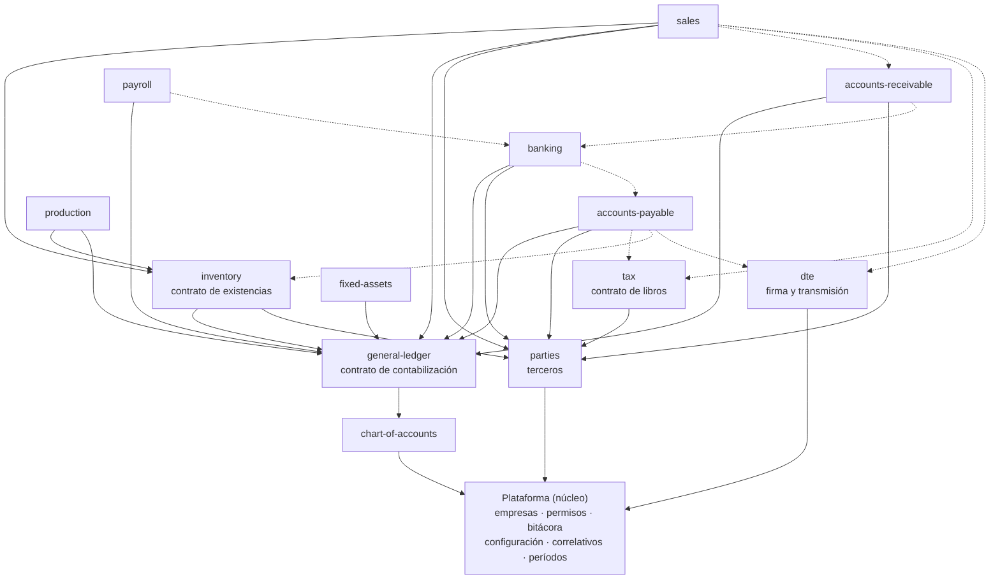

# Módulos de la plataforma nueva y orden de construcción

Forma final del sistema que reemplaza al MCERP: qué módulos habrá, qué posee cada uno, cómo dependen entre sí, qué
reglas transversales se adoptan y en qué orden se construyen. Los contratos entre módulos están en
[contratos.md](contratos.md); la vista de una página en [README.md](README.md).

> **Estado del documento: PROPUESTA de diseño** escrita sin el dueño presente. Cada decisión trae la alternativa
> descartada; lo que debe decidir el negocio lleva su número de [PREGUNTAS.md](../legacy/PREGUNTAS.md) (P1–P30) o una
> pregunta nueva (M1…). Fuentes: [integracion-legado.md](integracion-legado.md) y
> [plataforma-compartida.md](plataforma-compartida.md) (mandan sobre los specs de módulo), los specs de
> `docs/legacy/*/` y el código de `apps/api`, `packages/shared`, `modules/chart-of-accounts` y `modules/general-ledger`.
> Nada de lo legal (IVA, DTE, ISSS, AFP, renta, depreciación) se afirma como norma: se describe lo que hace el sistema
> anterior y se marca para verificar.

---

## 1. Mapa de módulos

### 1.1 Plataforma (núcleo, `apps/api` + `@accounting/shared`) — no es un módulo

Lo que todos usan y nadie posee se queda en el núcleo, con prefijo `core_`:

| Pieza | Hoy | Destino |
|---|---|---|
| Empresas | `core_empresas` | + `core_empresa_profile` (NIT, NRC, giro, actividad, dirección, logo): ficha fiscal **única** (hoy repartida en INV64, IVA64 y planilla) |
| Activación de módulos | `modules.is_enabled` global | + `core_empresa_modules` (módulo activo **por empresa**: producción, activo fijo y planilla son opcionales por cliente) |
| Configuración por empresa | `settings` global (solo puerto y nombre) | `core_empresa_settings` con espacio de nombres por módulo y **vigencia por fecha** ([contratos §8](contratos.md#8-configuración-y-correlativos)) |
| Correlativos | cada módulo numera lo suyo; el GL con `numbering.ts` | `core_sequences` para documentos con rango/serie (cheques, recibos, series fiscales, comprobantes de retención). Las partidas siguen numerándose en el GL |
| Estado de períodos | `gl_periods` (solo GL) | `core_periods` por empresa, mes y **área** ([contratos §2](contratos.md#2-estado-de-períodos)) |
| Permisos | 3 permisos (`capture`, `reports`, `supervise`) por rol | catálogo `módulo.acción` declarado en cada manifiesto + los 3 actuales como paquetes (§2.6) |
| Bitácora | `core_audit_log` (solo se escribe) | + ruta y pantalla de consulta |
| Catálogos de referencia de Hacienda | repetidos en cxc64 e IVA64 (departamentos, municipios, países, actividades, formas de pago) | tablas globales de solo lectura `core_ref_*`, sembradas por versión (no son registros de negocio: no llevan `empresa_id`) |
| Impresión y exportación | — | servicio común PDF/XLSX y almacén de adjuntos (`core_files`: PDF, JSON y QR del DTE, anexos generados) |
| Registro de servicios | — | el cargador de módulos expone los contratos que cada módulo **provee** (contratos §0) |

### 1.2 Módulos

| Id | Prefijo | Propósito | Absorbe del legado | Posee | Depende de | Publica a otros |
|---|---|---|---|---|---|---|
| `chart-of-accounts` (hecho) | `coa_` | Catálogo de cuentas | CONTAC: catálogo, agrupaciones | Cuentas | núcleo | lookup de cuentas |
| `general-ledger` (hecho) | `gl_` | Libro mayor: partidas, tipos, centros de costo, cierres, estados | CONTAC: partidas, cierres, presupuestos, reportes | Partidas, tipos de partida, **centros de costo**, años fiscales | `chart-of-accounts` | **contrato de contabilización**; lookup de centros de costo y saldos |
| `parties` (nuevo) | `pty_` | Maestro único de terceros (clientes y proveedores) | `CCCLI01`, `PROVEDOR` ×2, `CONTRIBU` ×2, `CLIENTES` ×2, `NOMBRES` | Terceros con sus identificadores fiscales y roles | núcleo | lookup de terceros |
| `banking` | `bnk_` | Cuentas bancarias, documentos bancarios, conciliación | BANCOC: Bancos | Bancos, cuentas, tipos de transacción, documentos (cheque, remesa, NC, NA, transferencia), conciliaciones | GL, `parties`; opcional `accounts-payable` | partida por documento; pagos aplicados a CxP; lookup de documentos bancarios |
| `accounts-payable` | `ap_` | Documentos por pagar y su pago; dueño del **documento de compra** | BANCOC: menú Cuentas por pagar; INV64 "Provisionar"; sujeto excluido (P23, INV 22) | Documentos de proveedor (quedan, CCF recibido, notas), provisiones, aplicaciones de pago, condiciones de proveedor | GL, `parties`; opcional `tax`, `inventory` | partida de provisión; renglón del libro de compras; emisión de DTE (sujeto excluido) |
| `accounts-receivable` | `ar_` | Cartera: cargos, recibos, aplicaciones, cheques, liquidaciones | cxc64 | Recibos, aplicaciones, cheques en cartera, liquidaciones, cargos manuales, condiciones de crédito del cliente | GL, `parties`; opcional `banking` | partida de recibos y cargos propios; lookup de saldos |
| `inventory` | `inv_` | Productos, bodegas, lotes, movimientos, costo promedio, toma física | INV64: maestro de artículos, movimientos, kárdex, cierre | **Productos**, bodegas, lotes, conceptos, movimientos, estado de costo | GL, `parties` | **contrato de existencias**; partida de movimientos que no son venta ni compra; lookup de productos |
| `sales` (nuevo) | `sal_` | Documentos de venta (CCF, factura, exportación, NC, ND) | INV64: facturación (`inmfac01/03`, `inmexp01`, `inmdevol`…) | Documentos de venta, series fiscales, listas de precio | `inventory`, `parties`, GL; opcional `accounts-receivable`, `tax`; `dte` (requerido para las empresas que emiten DTE) | **partida única de venta y costo**; cargo en CxC; libro de ventas; DTE emitido en el mismo grabado |
| `dte` (nuevo) | `dte_` | **Módulo nativo** de factura electrónica: arma, firma y transmite el DTE a Hacienda al facturar, e invalida o emite en contingencia | `FELECTRO`, `FANULAR`; absorbe la función de la solución `factura-electronica-mc` para los clientes migrados | Documentos DTE y sus intentos, numeración de control, invalidaciones, contingencia, establecimientos y puntos de venta, archivos (JSON, PDF con QR) y correo al receptor | núcleo (secretos, archivos, correlativos); opcional `tax` | contrato `dte` (emisión síncrona en la transacción del emisor + entrega asíncrona); estado del DTE |
| `tax` | `tax_` | Libros de IVA, renta retenida, archivos para Hacienda | IVA64; "Ingresar al IVA / Renta" de CONTAC y BANCOC | Renglones de libro (con enlace a su origen), comprobantes de retención, períodos de libro, corridas de anexos | núcleo, `parties` | **contrato de libros**; cálculo de impuestos como función compartida |
| `production` | `prod_` | Fórmulas, órdenes, costeo de producción | LOTE64 | Fórmulas, órdenes, enlaces a movimientos | `inventory`, GL | partida de producción |
| `fixed-assets` | `fa_` | Activos y depreciación mensual | AFIJO64 | Activos, categorías, ubicaciones, custodios, corridas | GL | partida de depreciación |
| `payroll` | `pay_` | Planilla, prestaciones, archivos de ley | plan64 | **Empleados**, conceptos, parámetros con vigencia, corridas | GL; opcional `banking` | partida de planilla |

Módulos que **no** quedan: `reports` (§1.4). El id del DTE es `dte` (el spec de INV64 sugería
`electronic-invoicing` con id `dte`; se usa `dte` en ambos para evitar dos nombres).

### 1.3 Fronteras decididas

| Tema | Decisión | Alternativa descartada y por qué |
|---|---|---|
| Bancos vs Cuentas por pagar | **Dos módulos.** `banking` paga; `accounts-payable` posee el documento de compra. El cheque aplica pagos a documentos de CxP por contrato | Un solo módulo como BANCOC: el legado ya permite trabajar sin CxP (`cfg_prove`) y CxP también lo alimentan compras de inventario y producción (maquila) |
| Inventario vs ventas vs DTE | **Tres módulos** (como propone `inv64/data-model.md` §2.1). `inventory` no conoce clientes ni impuestos; `sales` posee el documento fiscal; `dte` posee el DTE (armado, firma, transmisión, invalidación) | Facturación dentro de inventario como en INV64: es la causa de los defectos más graves (grabado de 8–12 tablas, cartera reescrita al imprimir, DTE por línea) |
| Dueño del documento de compra (P23) | `accounts-payable`. `inventory` registra la recepción y referencia el documento de CxP; producción (maquila) también | Inventario dueño (INV64 hoy): deja fuera las compras de gasto y duplica proveedor |
| Impuestos | `tax` posee **libros**, períodos de libro y anexos; **no** calcula al vuelo para otros: el cálculo es una función pura en `@accounting/shared` que usan `sales` y `accounts-payable` (§2.4) | `tax` como servicio de cálculo en tiempo de ejecución: obliga a activar `tax` para facturar y acopla el grabado de la venta a otro módulo sin necesidad |
| Series fiscales | `sales` (`sal_series`, respaldada por `core_sequences`) | `tax_series` (spec de IVA): la serie se consume al emitir, no al registrar en el libro |
| Establecimientos y puntos de venta | `dte` (`dte_establishments`); `sal_series` los referencia | En `sales`: son datos del emisor ante Hacienda, los usa también el sujeto excluido de CxP |
| Factura electrónica (decisión del dueño, 2026-11-12) | **Nativa en la plataforma:** el módulo `dte` firma y transmite directo a Hacienda como parte del flujo de ventas (contratos §6). **No se integra con la solución .NET**, que queda como implementación de referencia (sus JSON dorados y casos de rechazo son la suite de aceptación) y como herramienta de los clientes que siguen en el ERP anterior | **Puente de convivencia** (opción b de `dte/README.md` §5: bandeja `dte_outbox` con las columnas de `FELECTRO`/`FANULAR` que la solución .NET leyera por API). Razón del dueño: facturar debe enviar directo, sin la integración aparte. Costo aceptado: reimplementar firma y constructores en TypeScript (§5) |
| Clientes y proveedores | **`parties` (nuevo), siempre activo.** Un tercero puede ser cliente y proveedor; los atributos operativos van en el módulo que los usa (`ar_customer_terms`: límite, vendedor, plazo; `ap_supplier_terms`: plazo, cuenta) | `ar_customers` en CxC y `ap_suppliers` en CxP (specs): obligaría a activar CxC para facturar y CxP para registrar una compra en el libro, y repite el NRC en dos tablas (el legado ya tiene `CONTRIBU`/`CLIENTES`/`PROVEDOR` divergentes, integracion-legado §6). `tax_taxpayers` desaparece |
| Productos | `inventory` (`inv_items`, con `is_service` y `tracks_stock`) | En `sales`: producción, compras y ajustes también los usan |
| Centros de costo | `general-ledger` (`gl_cost_centers`, ya construido). Planilla y activo fijo usan esos; las "áreas" de activo fijo quedan como `fa_locations` (no son centros contables) | Catálogo propio por módulo (legado: 4 mecanismos) |
| Empleados | `payroll` (`pay_employees`). `fa_custodians` sigue en activo fijo con `employee_id` opcional; vendedores y cobradores en CxC (`ar_salespeople`) | Un maestro de personas en el núcleo: hoy no hay un solo flujo que lo necesite; se puede extraer después |
| Bancos (catálogo de instituciones) | `banking` posee `bnk_banks`; CxC y planilla guardan el banco del cliente/empleado como referencia a esa tabla vía lookup | Tres catálogos `BANCOS` como hoy |

### 1.4 `reports` deja de ser un módulo

Cada reporte pertenece al módulo dueño de la cifra (balance en GL, antigüedad en CxC, libros en `tax`). Los reportes de
**control entre módulos** (IVA del libro vs cuenta de IVA, cartera vs cuenta de control, existencias vs cuenta de
inventario) los posee el módulo cuya cifra se controla y leen el GL por el lookup de saldos. La consolidación entre
empresas es una consulta del GL. El render (PDF/XLSX) es un servicio del núcleo. El esqueleto `modules/reports` se
retira cuando se construya el servicio de impresión. *Alternativa descartada:* módulo de reportes que lea tablas de
todos — rompe la regla de que nadie lee tablas ajenas fuera de los contratos.

### 1.5 Diagrama de dependencias

Flecha = "depende de / llama a un contrato de". Punteado = opcional (el módulo funciona sin el otro).

---

## 2. Reglas transversales

### 2.1 Un estado de cierre por empresa, mes y área (no uno por módulo)

**Decisión:** una tabla del núcleo `core_periods` con estado por **área** (`gl`, `banking`, `ap`, `ar`, `inventory`,
`sales`, `tax`, `production`, `fixed_assets`, `payroll`) y el contrato `periods` (contratos §2). Reglas:
(1) la **fecha del documento** decide el período, nunca el "mes de trabajo" de la sesión; (2) GL cerrado ⇒ ningún módulo
contabiliza en ese mes; (3) cada módulo exige su propia área abierta para crear, modificar o anular; (4) reabrir pide
`supervise`, motivo y bitácora; (5) cerrar el GL de un mes **advierte** si hay áreas que contabilizan y siguen abiertas
(modo `advertir` por omisión; `exigir` configurable por empresa). `gl_periods` se migra a `core_periods` (área `gl`).
*Alternativa descartada:* tabla de cierre en cada módulo (como `inv_period_locks`, `ar_periods`, `tax_periods` de los
specs) — reproduce los seis mecanismos sin sincronizar del legado (integracion-legado §5). El área `tax` agrega el
estado `filed` (presentado). Planilla cierra **corridas**, no meses: su área solo controla el mes contable de la
partida. Decide el negocio: quién reabre y si el cierre del GL debe exigir el de los subledgers (P7, M1).

### 2.2 Una sola fuente para la venta y el costo de venta (P1)

**Decisión:** *el módulo dueño del documento contabiliza ese documento, y un documento tiene a lo sumo una partida viva.*
Por eso `sales` contabiliza **cada documento de venta** con una partida que lleva cliente (o caja), ingresos, IVA débito,
retención/percepción **y** costo de venta contra inventario (con el costo que devuelve `inventory` al registrar la
salida, congelado en la línea, P10). CxC **no** contabiliza ventas: solo recibos, cargos y créditos internos que él
posee. Las notas de crédito y débito son documentos de `sales`. `inventory` contabiliza solo movimientos que no son de
venta, compra ni producción (ajustes, toma física, transferencias con cambio de cuenta). Las compras las contabiliza
`accounts-payable` (inventario o gasto contra proveedor); la producción, `production`.
*Alternativas descartadas:* ventas desde CxC y costo desde inventario (dos partidas por factura, el problema de A4/A5
del legado); costo de venta en una partida mensual de inventario (deja el costo fuera del documento y pierde el
vínculo). Para el historial, las partidas de A4/A5 se importan como están (§3.6 y contratos §1.9).

### 2.3 Contabilización inmediata por documento, con resumen opcional

**Decisión:** la partida se crea **en la misma transacción** que emite, aplica o anula el documento. Granularidad
natural por origen: documento bancario = 1 partida; documento de CxP = 1 (provisión); venta = 1; recibo = 1; corrida de
depreciación = 1; corrida de planilla = 1; orden de producción = 1. Para orígenes de mucho volumen (consumidor final,
recibos) la empresa puede elegir **modo resumen por día** (`posting_mode = 'resumen_diario'`): el módulo arma un lote
del día con la lista de documentos y publica una partida con `source_ref` = id del lote; un documento nunca está en dos
lotes vivos. *Alternativa descartada:* lotes manuales por rango de fechas (legado A4–A8): traslapes, huecos y doble
conteo. Decide el negocio el detalle esperado (P6); el valor por omisión es "por documento".

### 2.4 Dónde se calculan los impuestos

**Decisión:** el **documento de origen** (venta en `sales`, compra en `accounts-payable`) calcula y **congela** IVA,
retención, percepción y renta al emitir, usando una función pura compartida
(`@accounting/shared/tax-calc`) y las tasas vigentes del contrato de configuración (namespace `tax`). `tax` **copia**
los importes al libro (igual que la solución DTE, que copia y no calcula: `dte/README.md`) y solo recalcula como
**control** (reporte de diferencias), nunca reescribe. El IVA mensual de consumidor final se calcula en el libro con la
fórmula del legado (IVA64 §3.4), porque así se declara. *Alternativa descartada:* que `tax` calcule (acopla emisión a un
módulo opcional) o calcular en dos lugares con reglas propias (lo que hace el legado: 21 sitios con la tasa en el código).
Decide el negocio: tasas y umbrales (P4, P5, P21, P22); redondeo por línea o por total (P21).

### 2.5 Saldos y existencias se calculan desde movimientos

**Decisión:** se calculan siempre (GL desde líneas — ya es así —, cartera y CxP desde aplicaciones, existencias desde
`inv_movements`, depreciación acumulada desde corridas). Única excepción: `inv_cost_state` (cantidad, valor y costo
promedio por producto) se mantiene **en la misma transacción** que cada movimiento, porque el promedio móvil necesita el
estado acumulado; es reconstruible y se verifica con un comando de recálculo. Cachés adicionales solo si el volumen lo
exige y siempre derivables. *Alternativa descartada:* tablas de saldos como `SALDOS`/`BODMES`/`MESES` — en el legado
divergen de sus movimientos.

### 2.6 Permisos por acción

**Decisión:** cada manifiesto declara permisos `módulo.acción` (p. ej. `banking.document.create`, `banking.document.void`,
`ap.document.post`, `tax.period.close`, `inventory.cost.view`, `payroll.salary.view`). Los tres permisos actuales
siguen y se vuelven **paquetes**: `capture` ⇒ crear y modificar; `reports` ⇒ ver y exportar; `supervise` ⇒ anular,
cerrar, reabrir, contabilizar manualmente, cambiar configuración. Se agregan dos sensibles que ningún paquete incluye por
omisión: `view_costs` y `view_salaries`. Ajuste por usuario y empresa en `core_user_permissions` (conceder / negar).
`requirePermission` acepta el permiso fino o su paquete. *Alternativa descartada:* portar las 630 claves de pantalla de
`PERFIL` (duplicadas, con huecos y sin empresa: plataforma-compartida §2). Decide el negocio (P9, N2).

---

## 3. Orden de construcción

### 3.1 Fases

| Fase | Qué se construye | Por qué en este orden | Necesita del negocio | Importable al final | Paridad que la cierra |
|---|---|---|---|---|---|
| **0. Cimientos** | Núcleo: `core_periods`, `core_empresa_settings`, `core_sequences`, permisos por acción, activación por empresa, `core_empresa_profile`, consulta de bitácora, registro de servicios; contrato de contabilización en el GL (§4); módulo `parties` | Todo lo demás publica partidas y lee terceros; construirlo después obliga a rehacer módulos | P2, P7, P9; M1 | Terceros desde `PROVEDOR` (las dos copias), `CCCLI01`, `CONTRIBU`, `CLIENTES`, con reporte de cruces por NRC (I1) | Pruebas del contrato; el historial del GL sigue cuadrando como hoy (18,570 saldos) |
| **1. Bancos y CxP** | `banking`, `accounts-payable` | Es el único flujo **inmediato** hacia el GL (A1): prueba el contrato con anular, modificar y meses cerrados. Primer pilotable | P6, P8, P22, P23, P28; BANCOC 9, 12, 18, 27 | `MOVIBAN`, `QUEDAN`, `NCREDEB`, `MOVQUE`, `PROVISIO`, cuentas, tipos; re-atribución de ~1,970 partidas `importado` → `bancos`/`cxp` | `bancoc/data-model.md` §4: saldo por cuenta = cuenta contable, CxP por proveedor, antigüedad, enlace documento↔partida |
| **2. Activo fijo** | `fixed-assets` | Pequeño, sin dependencias nuevas; prueba el posteo por **corrida** y la re-atribución por llave (`MOVDEPRE`) | P13, P14, P24, P25, P26 | `ACTIVO`, `MOVDEPRE`, catálogos; partidas → `activo_fijo` (menos 2023-01/02, P14) | `afijo64/data-model.md` §4.4 |
| **3. IVA** | `tax` (libros, renta, anexos, CSV) | Lo alimentan CxP (ya hecho) y captura manual; las ventas llegan por importación hasta la fase 4 | P4, P5, P21, P29 (formatos), P30; IVA 2, 4, 25 | `COMPRAS`, `IVAFIS`, `ivafac`, `RENTAT`, configuración | `iva64/data-model.md` §3.4 contra libros impresos |
| **4. Facturación** | `inventory`, `sales`, `accounts-receivable`, `dte` **nativo** (se construye junto con `sales`: firma, transmisión, invalidación, contingencia, PDF/QR, correo) | Bloque que en el legado se escribe **junto** (INV64 escribe `CCMOV01` y `FELECTRO` en el mismo grabado): no se puede separar en producción. El DTE se emite en el mismo grabado de la venta, así que `dte` no puede ir después | P1, P3 (fecha de producción), P10, P11, P12, P21, P27; INV 3–6, 24, 25; CXC 5, 11; certificado, credenciales y enlace a Internet de cada cliente (`dte/open-questions.md` 33–35) | `ARTICULO`, `MOVIMIEN`/`DATAMOV`, `CORFACT`/`FACT`, `CORDEV`/`DEVOL`, `CCMOV01`, `CCCLI01`, `FELECTRO`/`FANULAR`/`EnviosDTE`, archivos de `PDFPath`, último número de control por serie | `inv64` §3.3 y `cxc64` §4 (paridad), ventas por mes = libro de ventas; el módulo `dte` **aceptado en el ambiente de pruebas de Hacienda** y su JSON igual a los JSON dorados de la solución .NET por tipo |
| **5. Producción** | `production` | Depende de existencias; uso confirmado solo en un cliente con datos hasta 2020 (LOTE 1, 3) | LOTE 1, 3, 17; P10, P11 | `LOTE`, `DETALOTE`, `FORMULA`, `DETAFORM`; enlace a movimientos `PR`/`EP` | `lote64/data-model.md` §5.5 |
| **6. Planilla** | `payroll` | Mayor carga normativa y menor integración (no usa Bancos ni contabiliza hoy) | P16–P20, P29; PLAN 1.1–1.4 | `MAESTRO`, 48 quincenas de `PLANILLA`, catálogos, `CONFIG.MEM` como versión inicial | `plan64/data-model.md` §5.4 (±0.01 por empleado, reportado) |

### 3.2 Primer piloto

**Recomendación: un cliente con perfil "contabilidad + bancos (+CxP) + activo fijo", sin facturación en INV64**, al final
de la fase 2 (fase 3 si lleva IVA64 y sus compras salen de CxP). Razones: ese perfil existe en los datos (CONTAC +
BANCOC + AFIJO64 son de la misma familia de carpetas), usa los dos estilos de contabilización (inmediata y por corrida) y
no toca DTE ni cartera. Un cliente que factura necesita la fase 4 completa, incluido el módulo `dte` nativo, y es el **segundo** piloto. **Prerrequisito de salida a producción:** el módulo `dte` certificado/aceptado en el ambiente de pruebas de Hacienda para los tipos que ese cliente emite, con su certificado y credenciales cargados en el almacén de secretos.
Decide el negocio qué cliente concreto calza (M2) y entrega una copia completa de ese cliente de una misma fecha
(PREGUNTAS §2, sin la cual no hay paridad entre módulos).

### 3.3 Convivencia con el sistema anterior

**Regla:** un dominio lo escribe un solo sistema a la vez; los puentes son **de una vía (legado → nuevo)**,
idempotentes por llave legada y por **mes cerrado**; nunca se escribe en los `.DBF`.

Anillos que deben pasar juntos (porque el legado los une con escrituras inmediatas, integracion-legado §3):

| Anillo | Módulos nuevos | Motivo |
|---|---|---|
| A. Contabilidad | `general-ledger`, `chart-of-accounts` | Destino de todo |
| B. Pagos | `banking` + `accounts-payable` | `MOVIBAN`/`QUEDAN`/`PROVISIO` se escriben juntos (A1, A2, C2) |
| C. Facturación | `inventory` + `sales` + `accounts-receivable` + `dte` | `inmfac*` escribe `CCMOV01` y `FELECTRO` en un grabado (B1, F1); cxc64 edita `FACT` (B3). La emisión de DTE se mueve **con** la facturación |
| D. Opcionales | `fixed-assets`, `production` (con C), `payroll` | Se pueden mover solos |
| E. IVA | `tax` | Lee de B y C por traslado (lote): puede ir antes o después con un puente |

Puentes posibles (todos re-ejecutables, de solo lectura sobre el legado):
1. **Anillo A nuevo, C o D aún en el legado:** el legado sigue escribiendo sus partidas resumen en `PARTIDAS`/`DETAPART`
   de CONTAC aunque nadie use esas pantallas. Un **importador incremental de partidas** trae cada mes cerrado las que no
   estén ya importadas (por `SALFEC+TIPOPAR+NUMERO`), con `source = 'importado'` y el origen deducido; el mes se cierra en el
   GL nuevo después del puente.
2. **Anillo E nuevo, C en el legado:** el importador de `tax` lee `CCMOV01` (como hacía `ivatranc`) por mes; idempotente por
   llave del movimiento.
3. **Anillo B nuevo, C en el legado:** INV64 deja de poder provisionar a `QUEDAN` (C1): las compras de inventario se
   registran en CxP nuevo a mano, o el cliente espera la fase 4. Es el puente más débil: preferir clientes sin `cfg_prove`.
4. **Nunca** del nuevo hacia el legado.

**Facturación y DTE (regla de corte):** la facturación de una empresa pasa a la plataforma **toda a la vez junto con su emisión de DTE**. La solución .NET y el módulo nativo **nunca emiten los dos para la misma empresa y serie**: en el corte la solución .NET deja de emitir (se apaga su ciclo para esa empresa) y se entrega a la plataforma el **último número de control por serie** como piso de su correlativo (contratos §6.5, §6.12); el módulo nativo no emite hasta cargarlo. Los clientes que siguen en el ERP anterior siguen con la solución .NET sin cambios.

**Recomendación:** convivencia **por anillos con corte a inicio de mes**, no corte total; el anillo C se mueve completo.
Corte total (todo a la vez) solo para el cliente que factura si los puentes 1–2 no pasan la paridad.

### 3.4 Datos al corte

Al mover un anillo se importa el **histórico completo** de ese anillo (no saldos), se re-atribuyen sus partidas
(contratos §1.9) y se corre su paridad sobre los meses cerrados. Los saldos iniciales nunca se fuerzan: si falta
historial, partida de apertura única (decisión CONTAC 4).

---

## 4. Cambios en lo ya construido

Lista concreta, verificada contra el código actual (el detalle del GL está en
[contratos §1.8](contratos.md#18-cambios-en-el-gl-actual-verificados-contra-el-código)). Todo se hace en la fase 0.

| Área / archivo | Hoy | Cambio |
|---|---|---|
| `packages/shared/src/gl.ts` | `GL_ENTRY_SOURCES = manual, bancos, iva, cierre, importado` | + `cxp`, `cxc`, `ventas`, `inventario`, `produccion`, `activo_fijo`, `nomina`; `GL_GENERATED_SOURCES`; tipos del contrato |
| `modules/general-ledger/schema/entries.ts` | `source`, `source_ref`, índice no único `(source, source_ref)`; anular = `is_active = false` | Mismo enum ampliado; columnas `reverses_entry_id`, `legacy_ref`, `origin_confidence`; índice **único parcial** `(empresa_id, source, source_ref)` para generadas activas; migración del módulo |
| `modules/general-ledger/services/entries-write.ts` | `createEntry` graba siempre `source: 'manual'` dentro de `inTx` | Extraer `insertEntry(tx, data, origin)` y `replaceEntryLines(tx, row, data)` sin transacción propia |
| `services/entry-rules.ts`, `entry-detail.ts`, `entry-actions.ts` | `EDITABLE_SOURCES = manual, importado`; `SOURCE_MESSAGES` y `VOID_BLOCKED` solo para `bancos`/`iva` | Generalizar a `GL_GENERATED_SOURCES`; `applyEntry`/`unapplyEntry` rechazan generadas |
| `services/ledger-provider.ts`, `ledger-void.ts` (nuevos) | — | Implementación de `LedgerPosting` (contratos §1) sobre `validateLines`, `assignNumber`, `insertEntry` |
| `services/periods.ts` | `gl_periods` propia; `reopenPeriod` sin motivo | Delegar en el contrato `periods` (área `gl`); motivo obligatorio al reabrir; migrar `gl_periods` → `core_periods` |
| `services/numbering.ts` | `assignNumber` máximo + 1 por empresa, período y tipo | **Sin cambios** (correcto con un solo escritor) |
| `modules/general-ledger/manifest.ts`, `modules/chart-of-accounts/manifest.ts` | `permissions: { owner, admin, member }` que ninguna ruta usa | `provides` (`ledger`, `costCenters`, `balances`; `accounts`) y permisos `módulo.acción` |
| `packages/shared/src/manifest.ts` | `ModuleManifest` sin servicios | + `provides`, `consumes`, `permissions: PermissionDef[]`, `settingsSchema`, `optionalPerEmpresa` |
| `packages/shared/src/server/index.ts` | `ModuleEnv` con `db`, `user`, `empresaId`, `audit`; `requirePermission(Permission)` | + `services`; `requirePermission` acepta `'modulo.accion'` y resuelve paquete o permiso fino |
| `packages/shared/src/roles.ts` | 3 permisos por rol | Paquetes, permisos finos, `view_costs`, `view_salaries`; `can(role, perm, overrides)` |
| `apps/api/src/lib/module-loader.ts` | Habilitación global (`modules.is_enabled`), `topoSort` por `dependsOn` | Registro de servicios; verificar `consumes.required` al habilitar |
| `apps/api/src/middleware/module-context.ts` | Verifica empresa y acceso del usuario | + rechaza la ruta si el módulo no está activo para la empresa; inyecta `services` |
| `apps/api/src/db/schema-core.ts` | `core_empresas`, `core_user_empresas`, `core_audit_log` | + `core_empresa_profile`, `core_empresa_modules`, `core_empresa_settings`, `core_sequences`, `core_periods`, `core_user_permissions`, `core_files`, `core_ref_*` |
| `apps/api/src/routes` | No hay consulta de bitácora | `GET /audit` con filtros (plataforma-compartida §7) |
| `tools/legacy-import/src/contac/entries.ts` | Escribe SQL directo; `source = 'importado'`, `source_ref = SALFEC\|TIPOPAR\|NUMERO` | Llenar también `legacy_ref`; modo incremental por mes (puente 1, §3.3); función común `reattributeEntries` para los importadores de cada módulo |
| Esqueletos `modules/{accounts-payable,accounts-receivable,inventory,fixed-assets,payroll}` | Sin `empresa_id`, guardan saldos (`quantityOnHand`, `amountPaid`) | Reemplazar al construir cada módulo; `modules/reports` se retira |

---

## 5. Riesgos y decisiones abiertas

1. **Copia de datos coherente** (bloqueo de REPORTE): sin una copia de un solo cliente y fecha no hay paridad entre
   módulos ni prueba del puente 1.
2. **M1** — ¿Cerrar el GL de un mes exige que los subledgers del mes estén cerrados, o solo advierte? Propuesta: advertir.
3. **M2** — ¿Qué cliente es el primer piloto y qué módulos del legado usa de verdad? Propuesta: perfil A (§3.2).
4. **M3** — Terceros únicos (`parties`): al importar, ¿se unifican cliente y proveedor con el mismo NRC? Propuesta: sí,
   con reporte de cruces y revisión.
5. **P1/P2** — Si hubo ventas contabilizadas dos veces o partidas generadas editadas a mano, la re-atribución del
   historial queda `inferida` y la paridad del GL debe aceptar esas diferencias reportadas.
6. **P6** — El modo resumen diario puede no bastar si el contador quiere resúmenes por rango; se cubre con lotes
   explícitos, nunca rangos libres.
7. **Costo de venta con movimientos con fecha anterior** (P10): el costo se fija en el orden de grabado, no en el de la
   fecha; un movimiento atrasado no re-valúa ventas emitidas. Aceptado a cambio de documentos inmutables.
8. **Reimplementar en TypeScript la firma y todos los constructores de DTE** (decisión del 2026-11-12, contratos §6): es la
   opción más grande del spec (`dte/README.md` §5, opción d) y hay que replicar reglas finas aprendidas en producción. Se
   mitiga con los JSON dorados por tipo, los esquemas oficiales y los casos de rechazo del changelog como suite de aceptación.
9. **Normativa v2 del DTE** (2026-12-01 según el repositorio de la solución; **por verificar** contra la norma vigente):
   el módulo nativo debe nacer con la normativa vigente en su momento, y la solución .NET sigue cambiando; compite por el
   mismo equipo.
10. **Archivos de 200 líneas y transacciones síncronas:** los proveedores de contratos deben ser síncronos; cualquier
    trabajo asíncrono (envío de DTE, correo) queda como registro pendiente (p. ej. DTE `pendiente`) que procesa un trabajador fuera de la transacción.
11. **Dos bases de código fiscales:** mientras queden clientes en el ERP anterior, los cambios de normativa del DTE hay que
    seguirlos en la solución .NET y en el módulo nativo. Mitigación: el módulo nativo toma los esquemas y los JSON dorados de
    la solución como referencia y se corre una prueba de paridad en cada cambio de normativa.
12. **Piloto 2 depende de la certificación del módulo `dte`:** sin aceptación en el ambiente de pruebas de Hacienda para los
    tipos del cliente no hay salida a producción, y un retraso de `dte` retrasa el piloto 2. Pendiente: quién certifica por
    cliente y de dónde salen los certificados (`dte/open-questions.md` 33–34).
13. **Re-atribución inferida del historial:** las partidas de CxC, ventas, producción y planilla solo se reconocen por el
    texto del concepto; un concepto editado a mano queda como `importado`. Se acepta y se reporta.

---

## 6. Contradicciones entre documentos que este diseño resuelve

| Dónde | Qué dicen | Qué se decide aquí |
|---|---|---|
| `cxc64/data-model.md` (`ar_customers`), `bancoc/data-model.md` (`ap_suppliers`), `iva64/data-model.md` (`tax_taxpayers`) | Tres maestros de terceros | Uno: `parties` (§1.3) |
| `cxc64/data-model.md` §2 | "El IVA llega calculado por el servicio de `tax`" | Lo calcula el documento de origen con una función compartida; `tax` copia (§2.4) |
| `iva64` (`tax_series`) vs `inv64` (`sal_series`) | Series fiscales en dos módulos | `sal_series` sobre `core_sequences` |
| `inv64` (`inv_period_locks`), `cxc64` (`ar_periods`), `iva64` (`tax_periods`), GL (`gl_periods`) | Cierre por módulo | `core_periods` por área (§2.1) |
| `inv64/data-model.md` §2.5 | Orígenes `ventas` **y** `costo` | Solo `ventas`: una partida por documento con el costo (§2.2) |
| `inv64/data-model.md` §2.1 | Módulo `electronic-invoicing` con id `dte` | Id y nombre `dte` |
| `dte/README.md` §5 | Convivencia con bandeja `dte_outbox` leída por la solución .NET; módulo propio al final | Decidido el 2026-11-12: módulo `dte` nativo desde la fase 4, sin integración con la solución .NET (§1.3) |
| `dte/data-model.md` §4 | "Dinero en enteros" | Decimal exacto en texto, regla de la plataforma |
| `bancoc/data-model.md` (`bnk_settings.entry_number_width`) | Ancho del correlativo en Bancos | Lo fija `gl_entry_types.number_width`; el GL numera |
| `docs/legacy/README.md` §1 y §3 | `reports` implícito; "sistema de usuarios compartido"; LOTE64 "nuevo (lotes/producción)" | Sin módulo `reports` (§1.4); ocho copias (plataforma-compartida); módulo `production` |
| `lote64/README.md`, `inv64` §13.7 | "Nueve tablas" de inventario | Ocho (integracion-legado §2.4); da igual: pasan por el contrato `stock` |
| `bancoc/data-model.md` §4 y `cxc64` §4 | El importador "cambia `source`" como única excepción | Igual, pero como función del importador con `legacy_ref` y confianza (contratos §1.9) |
